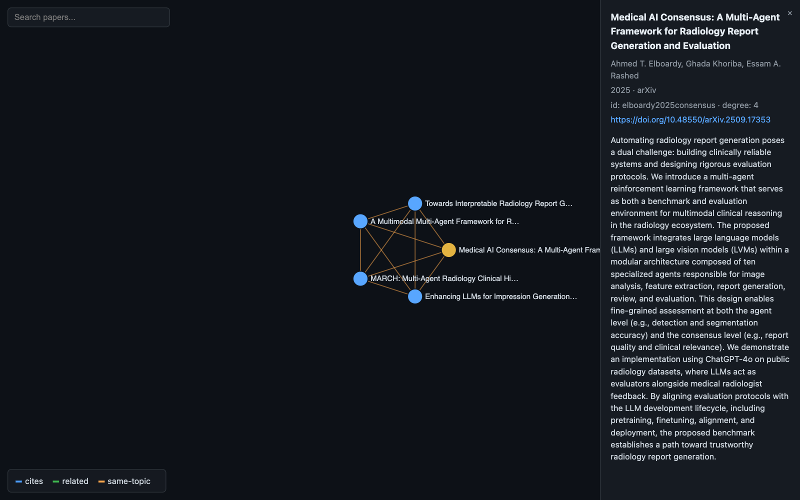

<div align="center">
<pre>
   ▄▄▄▄▄▄▄▄ 
 ▄▄█▀▀▀▀▀▀█ 
 █▀█▀▀▀▀▀▀█ 
 █ █▀▀▀▀  █ 
 █▄█▄▄▄▄▄▄█ 
</pre>
</div>

<p align="center"><strong>research-harness</strong></p>

<p align="center">
  A research harness built on oh-my-pi: review literature, grow a second brain of papers, and code — all local-first.
</p>

<p align="center">
  <a href="https://github.com/can1357/oh-my-pi"></a>
  <a href="../LICENSE"></a>
  
</p>

![omp TUI: the PRISMA-ScR flow diagram the harness derives from its own record store at the end of the capture. The lower half of the diagram is on screen — "Records screened (n=50)" branching to "Records excluded (n=4)" with the four exclusion reasons spelled out one per line (sequential pipeline, no mutual agent conditioning; not a diagnostic task; no inter-agent communication; no abstract), then "Reports sought for retrieval (n=1)", "Reports not retrieved (n=0)", ELIGIBILITY with "Reports assessed for eligibility (n=0)", and INCLUDED with "Studies included in review (n=0)". Below it two NOTE lines for the pending work (45 awaiting title/abstract screening, 1 awaiting full-text retrieval) and the arithmetic line that has to balance: "50 - 0 duplicates = 50 screened; 50 - 4 excluded - 45 pending = 1 sought; 1 - 0 not retrieved - 1 pending = 0 assessed; 0 - 0 excluded = 0 included". The status bar at the bottom reads "active: llm-agent-teams-hospital-diagnosis · 5/50 screened · type /help for commands".](../assets/research/guided-review-poster.png)

_[Watch the capture ↗](https://laansdole.github.io/research-harness/#guided-review)_ — 13 min 24 seconds, unedited, eleven typed lines. It follows this repo's own testing runbook, [docs/RUNBOOK.md](../docs/RUNBOOK.md): both Part 0 environment gates, then Part 1 as far as the first screening pass — a real 50-record PubMed export imported, deduped, abstract-filled, screened, confirmed, and counted. It stops at the PRISMA diagram; full-text retrieval, synthesis, the paper graph and export are documented in the runbook but not on camera.

## What it does

You type what you want in plain language and the harness carries the method: it frames your question as PCC/PICO, ingests your database exports into a per-record store, fills in the abstracts a PubMed CSV does not carry, screens each record against your own criteria with an evidence sentence, and shows you those verdicts before it writes any of them. Every number in the PRISMA-ScR flow diagram — the chart reviewers expect, counting what you found, screened, excluded and included — is derived from record state rather than typed. Covidence stays optional: `/export` writes RIS/BibTeX for Covidence, Zotero or EndNote whenever you want it.

You never have to remember any of it. `/help` prints the whole capability guide in plain words — what each command does and when you would reach for it — and the bar at the bottom of the screen keeps your place, reading `active: <project> · 5/50 screened · type /help for commands` and moving as you screen. Plain sentences work everywhere a command does.

Paywalled databases are never scraped. The harness writes the search string in each database's own syntax; you paste it, run it, and bring the export back:


## Commands

| Command | Does |
|---|---|
| `/scope <question>` | fuzzy question to PCC/PICO + inclusion/exclusion table; creates the project (or switches to an existing slug) |
| `/databases` | which databases to search for THIS question, with rationale, coverage gaps, and access notes |
| `/searchstring [db]` | ready-to-paste strings in each database's exact syntax (MeSH/Emtree/field tags), recorded under `searches/` |
| `/find` | run what CAN be run: arXiv + OpenAlex + local corpus, via the `scholar` agent |
| `/import <file>` | ingest RIS/BibTeX/CSV/JSONL exports into the per-record review store (`review.db`) with per-database counts; idempotent |
| `/dedupe` | mark duplicates in the store (DOI, then normalized title), survivors keep merged metadata |
| `/screen` | walk the unscreened queue with PCC verdicts per `SCREENING.md` — title/abstract or full-text stage — persisted per record; resumable (optional Jev pre-screen — see below) |
| `/fulltext` | OA-first retrieval cascade: OpenAlex -> Unpaywall -> arXiv -> local corpus -> web-search candidate you approve |
| `/prisma [--format]` | PRISMA-ScR flow diagram DERIVED from record states (text/mermaid/svg/html) |
| `/review` | synthesize a cited review from the includes, via the `synthesizer` agent |
| `/graph` | file the includes into the paper graph and view it inside the terminal (`paper_graph.py view`; inline PNG on Kitty terminals) |
| `/export <ris\|bib>` | write out the includes, all candidates, or the whole graph for Covidence/Zotero/EndNote |
| `/litreview <question>` | **the end-to-end shortcut** — search, screen, fetch, synthesize, graph, in one turn |

Each review lives in its own project folder under `~/.research-harness/projects/<slug>/`, so several reviews can run side by side. Full texts come from open-access PDFs only — OpenAlex, Unpaywall, arXiv, or your own folder of papers; a record that resolves to nothing is filed as not retrieved with a reason, never guessed at. [docs/ARCHITECTURE.md](../docs/ARCHITECTURE.md) has the full pipeline, data model and retrieval order.

## The optional Jev first pass

**A decision-only model.** TypeSafe's Jev never writes prose — it answers specific yes/no questions and hands back a probability for each one. That is the shape screening already has (one question per inclusion criterion), which is why it is fast and costs a small fraction of a general LLM.

**How the pass works.** Before the `screener` agent reads anything, each title/abstract record gets ONE call carrying one question per must-meet criterion from your scope. The banding is enforced in code, not judgment: at or above 0.90 auto-includes, at or below 0.10 auto-excludes, and everything in between — plus any record with no abstract — is left completely untouched for the agent and for you. It only removes the records nobody would have argued about; it never shrinks what a human sees.

**Auditable and reversible.** Each auto-verdict is written through the same review-store command a human verdict uses, and carries its provenance in the rationale — `[jev-1.13.0 p=0.04] exclude on criterion 'Context' (Concept=0.71, Context=0.04, Population=0.88)`: the model version that decided, and every per-criterion probability. Any of them can be checked or overturned later.

**Off by default.** Turn it on with `TYPESAFE_API_KEY="..."` in `~/.research-harness/config.env`; `research doctor` reports the first pass as OFF when no key is set, and with no key the workflow is byte-for-byte unchanged. Enabled, it is one API call per record.

Hands-on walkthrough: [docs/RUNBOOK.md](../docs/RUNBOOK.md), "Optional: a cheap first pass with Jev". Design — band rule, provenance, key resolution: [docs/ARCHITECTURE.md](../docs/ARCHITECTURE.md).

## Second-brain paper graph


_[Watch the capture ↗](https://laansdole.github.io/research-harness/#paper-graph)_ — six and a half minutes, unedited: the folder, the adds, the connection answer, and the export.

Point the `librarian` agent at a folder of papers and ask what connects them. Every reviewed paper lands in a local SQLite graph (`~/.research-harness/papers.db`) with typed edges — `cites`, `related`, `same-topic` — and `auto-edges` adds citation links verified against OpenAlex rather than inferred. The same operations are scriptable:

```sh
pg="python3 research/skills/paper-graph/scripts/paper_graph.py"
$pg add --id bert --title "BERT: ..." --doi 10.18653/v1/N19-1423
$pg auto-edges bert          # cites edges from OpenAlex
$pg export --format html     # one-file interactive viz
```



The export is ONE self-contained HTML file — node size by degree, edge colors by type, search, drag/zoom/pan, click for metadata. No external assets; it works from `file://` on a plane.

## Quickstart

```sh
git clone https://github.com/LaansDole/research-harness
cd research-harness
./setup.sh        # registers the plugin, agents, prompts and launcher — idempotent
research doctor   # checks omp, plugin, agents, prompts, corpus, and paper-graph db
research          # starts omp with the research mode prompt and the Research Harness welcome banner
```

Then type `/help` to see every command in plain words. To test-drive it on your own review — every step with the numbers you should see and what a different one means — follow [docs/RUNBOOK.md](../docs/RUNBOOK.md); the capture above walks its first half. Re-run `./setup.sh` after pulling: new commands only reach omp when it runs.

Requirements: [omp](https://github.com/can1357/oh-my-pi) installed, `python3` (stdlib only — no pip installs), and network access for arXiv/OpenAlex (a local folder of PDFs works fully offline).

## Under the hood

This is a fork of [can1357/oh-my-pi](https://github.com/can1357/oh-my-pi), so the whole coding agent is still here. The research layer is additive — it adds paths (`research/`, `assets/research/`, `setup.sh`, `bin/research`, `docs/`) and reaches stock omp through its plugin, prompt and agent extension points, so upstream changes rebase under it cleanly. The one exception is a small env-driven branding seam (`packages/utils/src/branding.ts` plus three fallbacks in the TUI welcome screen) that puts the paper-stack mark, the name and researcher tips on the welcome banner; with its variables unset omp renders stock ([docs/ARCHITECTURE.md §2.1](../docs/ARCHITECTURE.md#21-branding-seam)). Design doc: [docs/ARCHITECTURE.md](../docs/ARCHITECTURE.md); upstream's own README is the repository-root [README.md](../README.md), untouched.

**Staying in sync with upstream:** `main` is upstream's `main` plus a short stack of fork commits. A GitHub Action rebases that stack onto upstream every day and force-pushes `main` when the rebase is clean and the tests pass (the previous `main` is kept as `main-prev`); a conflict or a red test opens a `sync/rebase` pull request instead, landed with the `promote` label. Details: [docs/ARCHITECTURE.md](../docs/ARCHITECTURE.md#11-staying-in-sync-with-upstream).

## Credits

- Fork of [can1357/oh-my-pi](https://github.com/can1357/oh-my-pi), itself a fork of [badlogic/pi-mono](https://github.com/badlogic/pi-mono) by [@mariozechner](https://github.com/mariozechner).
- Literature data: [arXiv](https://arxiv.org) export API and [OpenAlex](https://openalex.org) (both keyless), plus [Unpaywall](https://unpaywall.org) for OA locations when a contact email is configured — honest User-Agent; open-access sources only.
- Terminal demos rendered with [charmbracelet/vhs](https://github.com/charmbracelet/vhs); the captures play at full quality on [GitHub Pages](https://laansdole.github.io/research-harness/). GitHub will not render a committed MP4 above about 1 MB and serves repository blobs as downloads, so a repo-committed video cannot be watched in place — the page exists for that reason.

