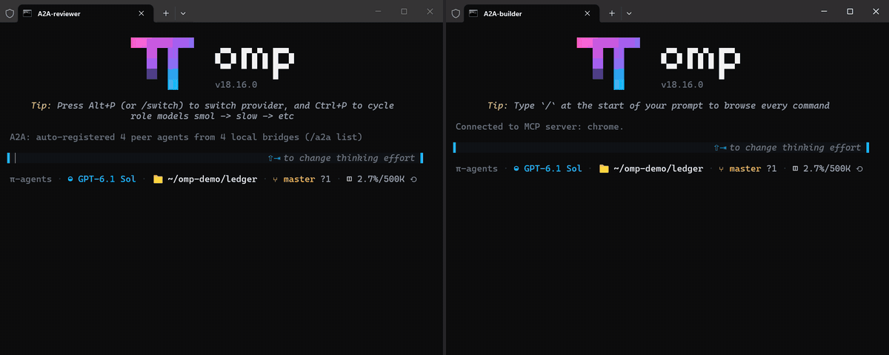
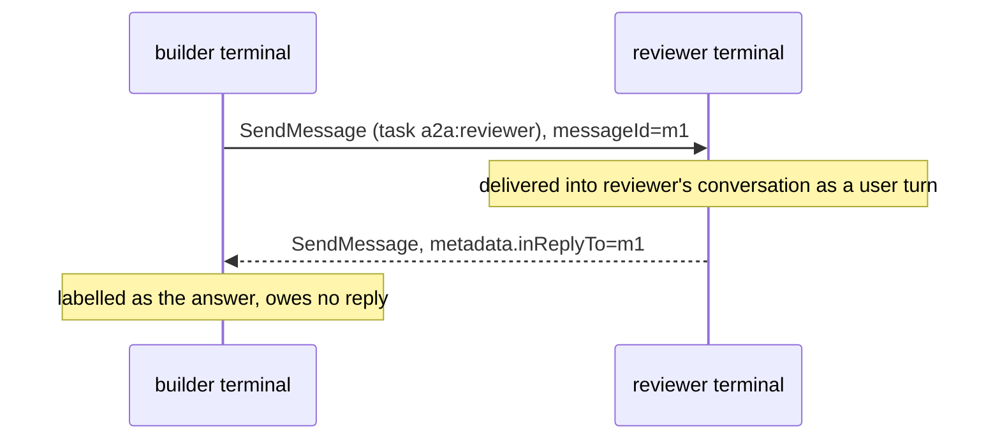
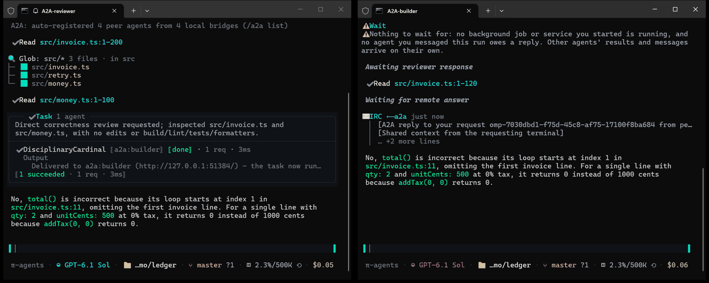
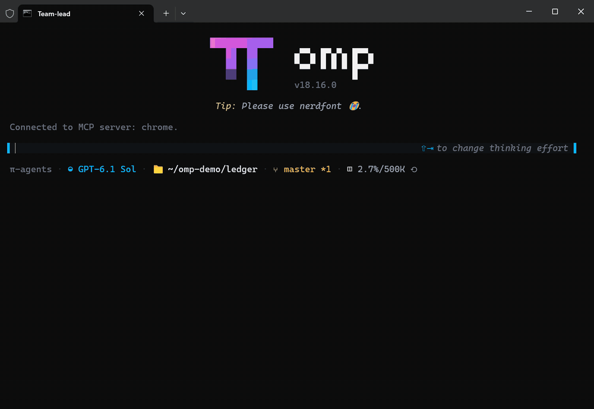

# oh-my-pi-team-agents

A research fork of [oh-my-pi](https://github.com/can1357/oh-my-pi) (`omp`) about **how coding agents talk to each other**: agents in separate terminals, teammates inside one session, and the guards that keep agent-to-agent traffic bounded.

[Русская версия](README-RU.md) · [Feature reference](README-EN.md) · [Build & maintenance](README-fork.md)

<p align="center">
  
</p>

## What this fork studies

The companion article [**Inside Claude Code: how agents talk and how Agent Teams work**](https://llmcrew.org/wiki/claude-code-agent-teams-internals) (RU, Claude Code 2.1.311, static analysis of the binary) reconstructs Claude Code's agent messaging: `SendMessage` routing, file-backed teammate mailboxes, report hand-back, recovery, limits and trust boundaries.

This fork is the hands-on half of that research: the same problems implemented in an open agent, then exercised with real terminals and models. Every mechanism below is runnable and was checked live (see [Verified live](#verified-live)).

| Problem | Claude Code 2.1.311 (per the article) | This fork |
|---|---|---|
| Two separately started sessions | `local-session` route: JSONL over a Unix domain socket, session file `~/.claude/sessions/<pid>.json` | A2A v1.0 bridge: JSON-RPC 2.0 over HTTP on `127.0.0.1`, bearer token, per-process registry file `a2a-bridges/<pid>.json` |
| Teammate messaging | File mailboxes `~/.claude/teams/<team>/inboxes/<agent>.json` | In-process IRC bus, `write agent://<handle>`, with an ingress guard |
| Team definition | Runtime state in `config.json`, rewritten by the harness | Declarative file `.omp/teams/<name>.md`, started with `/team start` |
| Shared task list | `~/.claude/tasks/<team>/` | `TASKS.md` in the team workspace; claims are a convention, not a lock |
| Report back to the caller | `SubagentHandback`: one report, indentation framing | `handback` tool: one report per run, "model output, not user text" frame, harness-tag escaping |
| Who a peer message speaks as | Envelope `cross-session-message`; local hash ledger (not a signature) | A peer terminal's request is a **user** turn, never a developer message; harness tags in the body are escaped |
| Team control protocol | `shutdown_*`, `plan_approval_*`, `idle_notification` | Not implemented |

## Mechanisms

### 1. Cross-terminal agents (A2A bridge)

Every `omp` process serves an [A2A v1.0](https://a2a-protocol.org) bridge on a free loopback port and registers itself in the machine-local bridge registry. A new session discovers the live bridges and exposes their main agents as `a2a:<name>` targets of the ordinary `task` tool.



- Address a terminal by name: start it with `omp --a2a-name reviewer`, or let it auto-name as `<cwd-slug>-<pid>`.
- The request lands in the receiving terminal's **main conversation**; that agent answers itself or delegates to its own subagents.
- The reply is correlated automatically (`metadata.inReplyTo`). If the receiving main agent answers in plain text instead of calling `task`, its last text of the turn is relayed to the requester.
- Loopback only, bearer token `~/.omp/agent/a2a.token`, `SendMessage` / `SendStreamingMessage` (SSE) / `GetTask` / `ListTasks` / `CancelTask`.

Wire contract and settings: [docs/a2a.md](docs/a2a.md).



### 2. Agent Teams (in-session)

A team file declares members, handles, a shared workspace and the protocol they follow. `/team start <name>` spawns every member as a full subagent with a stable handle; members message each other directly with `agent://<handle>` and coordinate through `TASKS.md`.

```markdown
---
name: review
description: Two-person code review crew
workspace: ./ws
members:
  - agent: task
    handle: Scout
    role: Find defects in src/
  - agent: task
    handle: Reviewer
    role: Confirm or reject each finding against the code
context: |
  Scout writes each finding to agent://Reviewer and waits for the verdict;
  Reviewer answers agent://Scout with CONFIRMED or REJECTED;
  only Scout reports to the lead. Do not edit src/.
---
Review src/invoice.ts and src/money.ts.
```

<p align="center">
  
</p>

`/team list`, `/team status`, `/team stop [name|all]`. Enable with `team.enabled: true`; at most `team.maxTeammates` (default 4) members. Details: [docs/agent-teams.md](docs/agent-teams.md).

> [!IMPORTANT]
> Pick member definitions that may write and talk. A member's own definition prompt outranks the team context: the bundled read-only `scout` refuses to touch `TASKS.md`, and the structured-output `reviewer` reports through its own schema instead of messaging peers. The general `task` agent follows the team protocol.

### 3. Guards for agent-to-agent traffic

| Guard | What it bounds | Setting |
|---|---|---|
| IRC ingress guard | Per-sender rate, 30 s dedup window, relay hops ≤ 28, queue ≤ 50; refusals are receipts, not errors | `irc.ingressGuard`, `irc.rateLimitTokens`, `irc.dedupWindowMs`, `irc.maxHops` |
| Refuse instead of queue | When `task.maxConcurrency` is exhausted, a spawn fails with numbers and "Do not retry" instead of waiting silently; covers task, A2A, extensions and workflow spawns | `task.concurrencyPolicy: refuse` |
| Subagent token budget | At 50 % a `<total_tokens>N tokens left of M</total_tokens>` notice, at 90 % a wrap-up steer | `task.tokenBudget` |
| Capability tokens | A destructive operation (dirty worktree removal, killing an agent with unsaved output) first refuses with a one-shot `<8hex>@<id>` token; the retry with `force` executes | — |
| Peer authority | Text from another terminal reaches the model as a user turn, so it never carries developer authority | — |

### 4. Deterministic workflow orchestration

The `workflow` tool runs a JS script in a `node:vm` sandbox with an allowlist of globals (`agent`, `parallel`, `pipeline`, `phase`, `log`, `clock`, `args`; no `require`, `Date.now`, `Math.random`). Every agent call is journaled; after a kill, `resumeFrom` replays completed calls from the journal and runs only the unfinished tail. Reference: [docs/tools/workflow.md](docs/tools/workflow.md).

### 5. Other additions

- `pi.spawnSubagent({agent, prompt})` lets extensions start subagents under the shared concurrency limit.
- [chrome-mcp](https://github.com/spgsroot/mcp-chrome-2026-en) is auto-discovered on `127.0.0.1:12306` as the default browser: `chrome_*` tools in your real Chrome. The built-in `browser` tool stays as the isolated fallback.

## Verified live

Run on 2026-11-08: Windows 11, binary built from `main`, model `openai-codex/gpt-6.1-sol:high`, real terminal windows, isolated profile (`OMP_PROFILE=agents`). Demo repository: a three-file `ledger` service with a seeded off-by-one in `total()`.

| Mechanism | Scenario | Result |
|---|---|---|
| A2A request and answer | builder asks `a2a:reviewer` whether `total()` is correct | Answer back in 22 s, labelled as the reply to the request (GIF above) |
| A2A, never-prompted receiver | Same request into a fresh terminal | Failed 3 of 3 before `b7c805f4fb` (request arrived as a developer message, model asked "what would you like me to do?"); answered after the fix |
| A2A plain-text answer | Receiver answers in its own chat instead of calling `task` | Relayed to the requester with `inReplyTo` |
| Agent Teams | `/team start review`, `/team status` | Both members claimed rows in `TASKS.md`, Scout and Reviewer messaged each other, Scout reported confirmed findings |
| Agent Teams with `scout`/`reviewer` definitions | Same team, bundled definitions | Members ignored the team protocol (see the note above) |
| Workflow resume | Two-phase script killed mid-run, resumed with `resumeFrom` | Completed calls replayed from the journal, only the unfinished call ran |
| Refuse policy | `maxConcurrency: 1`, three parallel scouts | One ran, two refused with "Do not retry" |
| Token budget | 30 000-token budget, subagent reads every file | `<total_tokens>13896 tokens left of 30000</total_tokens>` injected |
| `handback` | Subagent ends with a 3-line report | Report delivered in the framed envelope. One earlier run with `task.structured: true` was marked `failed (exit 1)` after a successful `handback`; not investigated |
| `pi.spawnSubagent` | Project extension tool spawns a scout | Scout result returned to the calling session |
| chrome-mcp | List windows and tabs | Real Chrome windows listed |
| Capability token on kill | `proc://<agent>/kill` | Not triggered live (the agent's transcript was already on disk, so no unsaved work); covered by `test/capability-token.test.ts` |

Mechanism suites: `test/a2a-*.test.ts`, `test/session/irc-bridge-relay.test.ts`, `test/irc-*.test.ts`, `test/teams.test.ts`, `test/workflow.test.ts`, `test/token-budget.test.ts`, `test/handback.test.ts`, `test/capability-token.test.ts`.

## Quick start

Build from source (Bun ≥ 1.4.4 and a Rust toolchain for the native addon):

```sh
git clone https://github.com/spgsroot/oh-my-pi-team-agents.git
cd oh-my-pi-team-agents
bun install
bun --cwd=packages/natives run build
bun run --cwd packages/coding-agent build
./packages/coding-agent/dist/omp --version
```

Keep it apart from a production `omp`: run the fork binary with its own profile, e.g. `OMP_PROFILE=agents`. Then:

```sh
# terminal 1
omp --a2a-name reviewer
# terminal 2
omp --a2a-name builder
#   > read agent://              (lists a2a:reviewer)
#   > Ask a2a:reviewer whether total() in src/invoice.ts is correct.

# teams
omp config set team.enabled true
#   > /team start review
```

Build details, upstream sync and the isolated-profile wrapper: [README-fork.md](README-fork.md).

## Known limitations

- An A2A answer depends on the receiving model following the envelope; the plain-text relay covers only the receiving terminal's main agent, not its subagents.
- A2A is machine-local (loopback). There is no cross-terminal team membership.
- No team control protocol: no shutdown approval, plan approval or idle notifications.
- `TASKS.md` claims are a convention; two members can edit the same row.
- An A2A pending spawn past the 30 s grace is reported as failed; poll `GetTask` by task id.
- Workflow cannot interrupt async continuations after the first `await`.

Full list: [FORK-RU.md](FORK-RU.md#известные-ограничения) (RU).

## Documentation

| Topic | Document |
|---|---|
| A2A wire contract, settings | [docs/a2a.md](docs/a2a.md) |
| Agent Teams file format, commands | [docs/agent-teams.md](docs/agent-teams.md) |
| Workflow tool | [docs/tools/workflow.md](docs/tools/workflow.md) |
| All fork features and settings | [README-EN.md](README-EN.md) · [FORK-RU.md](FORK-RU.md) |
| Upstream omp (install, providers, tools) | [can1357/oh-my-pi](https://github.com/can1357/oh-my-pi) |

## License

MIT, inherited from [oh-my-pi](https://github.com/can1357/oh-my-pi), which is a fork of [Pi](https://github.com/badlogic/pi-mono) by [@mariozechner](https://github.com/mariozechner). Fork additions by [spgsroot](https://github.com/spgsroot).
