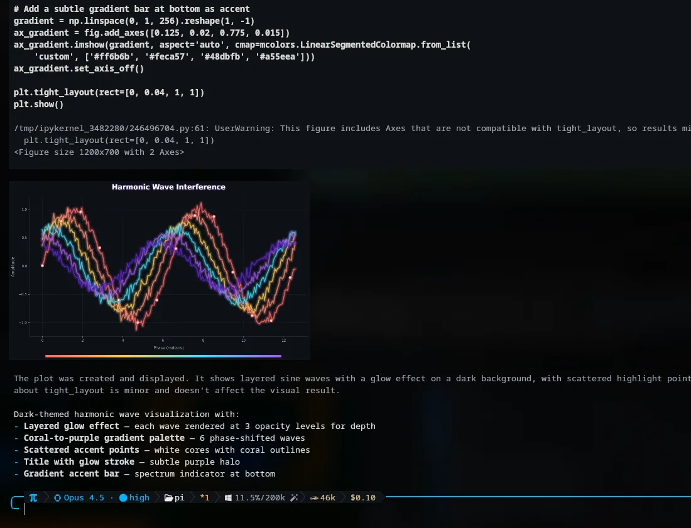
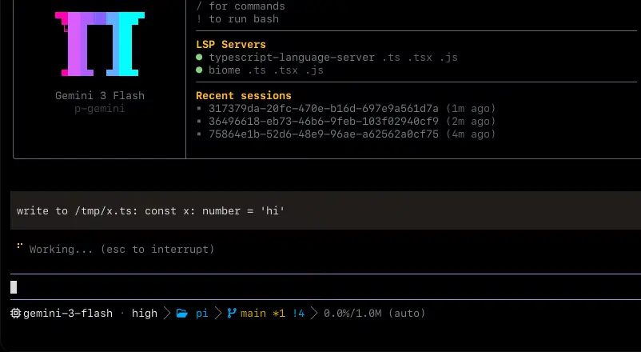
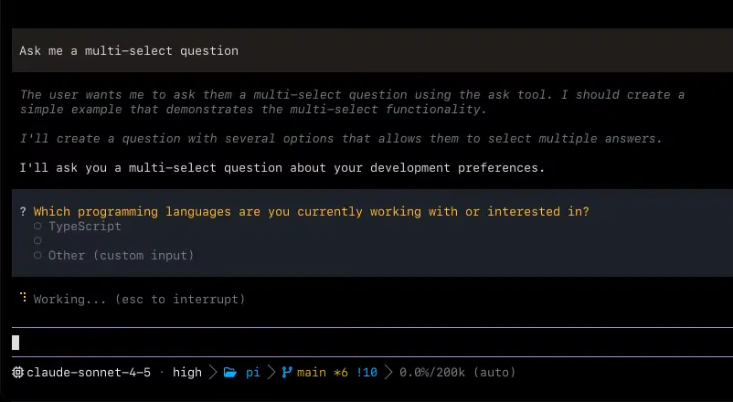

<p align="center">
  
</p>

<p align="center">
  <strong>Coding agent со встроенным IDE.</strong>
  <strong><a href="https://omp.sh">omp.sh</a></strong>
</p>

<p align="center">
  Language: <a href="README.md">English</a> | <a href="README.zh-CN.md">简体中文</a> | <strong>Русский</strong>
</p>

<p align="center">
  <a href="https://www.npmjs.com/package/@oh-my-pi/pi-coding-agent"></a>
  <a href="https://github.com/can1357/oh-my-pi/blob/main/packages/coding-agent/CHANGELOG.md"></a>
  <a href="https://github.com/can1357/oh-my-pi/actions"></a>
  <a href="https://github.com/can1357/oh-my-pi/blob/main/LICENSE"></a>
  <a href="https://www.typescriptlang.org"></a>
  <a href="https://www.rust-lang.org"></a>
  <a href="https://bun.sh"></a>
  <a href="https://discord.gg/4NMW9cdXZa"></a>
</p>

<p align="center">
  Сделано в <a href="https://stencil.so">Stencil Labs</a> · форк <a href="https://github.com/badlogic/pi-mono">Pi</a> от <a href="https://github.com/mariozechner">@mariozechner</a>
</p>

Самая мощная из поставляемых поверхностей agent. Непрерывно настраивается под реальное использование — полная из коробки и открытая до самого основания.

**60+** providers · **31** встроенный tool · **14** lsp ops · **28** dap ops · **~80k** строк Rust-ядра.

> [!NOTE]
> Pull requests **временно открыты всем** в порядке эксперимента. Раньше мы
> требовали поручительство перед приёмом PR; сейчас это требование снято,
> пока мы оцениваем, как идут открытые контрибуции. В зависимости от
> результатов система поручительства может вернуться.

## Установка

**macOS · Linux**

```sh
curl -fsSL https://omp.sh/install | sh
```

Если работоспособного bun нет (или указан `--binary`), install-скрипты скачивают готовый бинарник с `build.stencil.so` и проверяют его SHA-256 перед установкой. Закрепить релиз: `curl -fsSL https://omp.sh/install | sh -s -- --binary --ref v<version>` (PowerShell: `-Binary -Ref v<version>`).

> **Alpine / musl:** готовый musl-бинарник динамически линкует `libstdc++`/`libgcc`, а в стандартном Alpine их нет. Сначала установите их: `apk add libstdc++ libgcc`.

**Homebrew**

```sh
brew install can1357/tap/omp
```

**Bun (рекомендуется)**

```sh
bun install -g @oh-my-pi/pi-coding-agent
```

**Nix**

```sh
# Run without installing
nix run github:can1357/oh-my-pi

# Or install into the active profile (Nix < 2.30: `nix profile install`)
nix profile add github:can1357/oh-my-pi
```

Пользователи flake могут использовать `packages.<system>.omp`, `overlays.default`, `nixosModules.default` или `homeManagerModules.default`. Конфигурация Home Manager может установить OMP и декларативно владеть его настройками:

```nix
{
  inputs.omp.url = "github:can1357/oh-my-pi";

  # In your Home Manager module:
  imports = [ inputs.omp.homeManagerModules.default ];
  programs.omp = {
    enable = true;
    settings.startup.quiet = true;
  };
}
```

**Windows (PowerShell)**

```powershell
irm https://omp.sh/install.ps1 | iex
```

**Закреплённые версии (mise)**

```sh
mise use -g github:can1357/oh-my-pi
```

macOS · Linux · Windows · bun ≥ 1.4.4

### Автодополнение оболочки

`omp` генерирует собственные скрипты автодополнения для **bash**, **zsh** и **fish** из живых метаданных команд и флагов, поэтому они никогда не расходятся с реальным CLI. Подкоманды, флаги и значения enum дополняются статически; имена models (`--model`, `--smol`, `--slow`, `--plan`) разрешаются по встроенному каталогу models, а `--resume` — по вашим session на диске.

```sh
# zsh — add to ~/.zshrc (or write the output into a file on your $fpath)
eval "$(omp completions zsh)"

# bash — add to ~/.bashrc
eval "$(omp completions bash)"

# fish
omp completions fish > ~/.config/fish/completions/omp.fish
```

## Каждый tool, _benchmaxxed_.

Правки, которые проходят с первой попытки. Чтения, которые суммируют файлы вместо того, чтобы вываливать их содержимое. Поиски, которые возвращаются мгновенно. Берите любую model — omp сделает правильно.

| model            | метрика      | что                                                                   |
| ---------------- | ------------ | --------------------------------------------------------------------- |
| Grok Code Fast 1 | 6.7% → 68.3% | Десятикратный рост в тот момент, когда формат правок перестаёт съедать model заживо. |
| Gemini 3 Flash   | +5 pp        | Против str_replace — превосходит собственную лучшую попытку Google в этом формате. |
| Grok 4 Fast      | −61% tokens  | Вывод схлопывается, как только исчезает цикл ретраев на плохих диффах. |
| MiniMax          | 2.1×         | Доля прохождений более чем удваивается. Те же веса, тот же prompt.     |

- `read` : суммированные фрагменты · идеальные дефолты · hit rate селектора
- `grep` : самый быстрый на Диком Западе
- `lsp` : всё, что знает ваш IDE, знает agent
- `prompts` : безжалостно подгоняются под каждую model

[Читать полный пост ↗](https://blog.can.ac/2026/02/12/the-harness-problem/)

## Тот самый Pi, _который вы любите_, с **батарейками в комплекте**.

Изначально построенный на прекрасном [Pi](https://github.com/badlogic/pi-mono) от [Mario Zechner](https://github.com/mariozechner), omp добавляет всё, чего вам не хватает.

### 01 · Исполнение кода с tool-calling

Большинство harness дают agent Python-песочницу и на этом останавливаются. Наш запускает постоянный Python и Bun-воркер, и любое из ядер может вызывать собственные tools agent — read, поиск, task — через loopback-мост. Agent загружает CSV через tool.read прямо из Python, строит по нему график из JavaScript и не покидает ячейку.



### 02 · LSP, встроенный в каждую запись

Попросите переименование — и получите переименование. Вызов идёт через workspace/willRenameFiles, поэтому ре-экспорты, barrel-файлы и алиасированные импорты обновляются до того, как файл сдвинется. Всё, что знает ваш IDE, знает agent.



_[Документация по конфигурации LSP](docs/lsp-config.md)_

### 03 · Управляет настоящим отладчиком

C-бинарник падает с segfault: agent подключает lldb, доходит до плохого указателя, читает фрейм. Go-сервис зависает: он подключает dlv и обходит горутины. Python-процесс заклинило: debugpy, pause, inspect, evaluate. Большинство agent всё ещё рассыпают print-выражения.


_[Смотреть запись ↗](https://omp.sh/clips/dap.mp4)_

### 04 · Потоковые правила, путешествующие во времени

Ваши правила лежат без дела, пока model не сойдёт со сценария. Совпадение regex прерывает поток посреди токена, вставляет правило как system reminder и повторяет попытку с той же точки. Вы получаете коррекцию курса, не платя context tax на каждом ходу. Инъекции переживают compaction, поэтому исправление держится.


_[Смотреть запись ↗](https://omp.sh/clips/ttsr.mp4)_

### 05 · Subagents первого класса

Разделите работу между воркерами и получите обратно типизированные результаты. task разворачивается в изолированные worktree, каждый воркер запускает собственную поверхность tools, а итоговый yield — объект, проверенный по схеме, который родитель читает напрямую. Никакой прозы для парсинга, никаких merge-конфликтов между соседями, никаких осиротевших правок.


_[Смотреть запись ↗](https://omp.sh/clips/irc.mp4)_

Смотрите fan-out прямо во время работы: `Alt+A` открывает [Agent Hub](docs/agent-hub.md), где roster показывает текущую активность и расход каждого subagent. Откройте одного, чтобы прочитать его живой транскрипт, отправить steering-сообщение, оживить припаркованного воркера или убить зависшего, не прерывая родительский session.

### 06 · Второй model, следящий за каждым ходом.

Привяжите reviewer-model к роли 'advisor', и он будет читать каждый ход, который делает основной agent, вставляя заметки по ходу — тихое замечание, сомнение или жёсткий блокер. Он работает на собственном контексте и собственном model, поэтому замечает то, мимо чего исполнитель проскочил. Основной agent видит заметку и корректирует курс — или объясняет, почему не станет.


_[Смотреть запись ↗](https://omp.sh/clips/advisor.mp4)_

### 07 · Отдайте кому-то ссылку — и он внутри.

/collab помещает ваш живой session на relay и возвращает ссылку — и QR. Коллега подключается из другого терминала через omp join или просто открывает её в браузере. Делитесь read-write, чтобы работать в паре на одном agent, или используйте /collab view для read-only ссылки, которую любой может смотреть, но никто не может направлять. Фреймы шифруются на стороне клиента; relay никогда не видит ваши ключи.


_[Смотреть запись ↗](https://omp.sh/clips/collab.mp4)_

### 08 · Прочитать pdf на arxiv — почему бы и нет?

web_search выстраивает цепочку из двадцати трёх ранжированных providers и передаёт найденные URL напрямую в read. Arxiv PDF, страницы GitHub, треды Stack Overflow возвращаются структурированным markdown с целыми якорями — та же поверхность tools, которую вы используете на локальных файлах. Цитируйте, переходите, заимствуйте — и никогда не теряйте, откуда пришли.


_[Смотреть запись ↗](https://omp.sh/clips/web.mp4)_

### 09 · Бескомпромиссно нативный. Даже на Windows.

Другие agents вызывают rg, grep, find и bash через шелл. На многих машинах этих бинарников нет, а там, где они есть, каждый вызов стоит round-trip fork-exec. omp линкует настоящие реализации в процесс. ripgrep, glob, find: in-process. bash — наш собственный движок bash 5.3, с session, которые переживают вызовы, и 58 утилитами командной строки (ls, sed, sort, xargs, даже jq), портированными в crate builtins и работающими in-process, без fork/exec. Тот же бинарник omp работает на macOS, Linux и Windows — без моста WSL.

### 10 · Code review с приоритетами и вердиктом

Получите ясный вердикт о том, уходит ли изменение в релиз, с каждым issue, ранжированным от P0 до P3 и оценённым по уверенности. [/review](docs/slash-command-internals.md#15-bundled-command-note-review) порождает выделенных reviewer-subagents, которые параллельно прочёсывают ветки, отдельные коммиты или незакоммиченную работу. Сначала беритесь за то, что блокирует релиз; ничего важного не прячется в стене текста.

Хотите направлять review сами? `/annotate code-review` открывает diff, чтобы вы могли прикрепить заметки к строкам до запуска reviewers. `/annotate` также принимает последний ответ, сообщение session, файл или цитируемый текст и вставляет ваши заметки в prompt. См. [`/annotate`](docs/slash-command-internals.md#12-bundled-command-note-annotate).

### 11 · Hashline: правка по хешу содержимого

Идеальные правки, меньше токенов. model указывает на якоря вместо повторного набора строк, которые хочет изменить, так что битвы за пробелы и циклы string-not-found просто перестают случаться. Отредактируйте устаревший файл — и якоря разойдутся: мы отвергаем патч до того, как он что-то испортит. Grok 4 Fast тратит на 61% меньше output-токенов на той же работе.

### 12 · GitHub — просто ещё одна файловая система

Другие harness прикручивают gh_issue_view, gh_pr_view, gh_search — каждый со своими параметрами, которые agent должен выучить, а вы отлаживать. Мы это пропустили. read уже умеет работать с путями; PR — это пути. Один интерфейс, которому нужно научить model, одна поверхность, которую нужно держать корректной.

### 13 · Память, которую agent курирует сам

agent помнит вашу кодовую базу между session. Он пишет факты на ходу через retain, фиксирует переиспользуемые уроки через learn, достаёт их обратно через recall и сжимает каждый session в mental model, которая загружается на первом ходу следующего. Движок выбирается через `memory.backend` — local, Hindsight или Mnemopi. По умолчанию область — проект, поэтому выученное про этот repo остаётся с этим repo.

### 14 · ACP: agent, управляемый редактором

Запустите omp внутри Zed — и получите того же agent, которым управляете из терминала: он читает буфер, на который вы действительно смотрите, пишет через путь сохранения редактора, запускает шеллы в терминале редактора. Деструктивные tools приостанавливаются для запроса разрешения, на который можно ответить один раз и забыть. Никакого моста, никакого plugin, никакого второго мозга, который нужно синхронизировать.

### 15 · Наследует то, что уже написали ваши другие tools

Каждый другой agent поставляет импортёр и ждёт, что вы будете конвертировать. omp читает восемь форматов, уже лежащих на диске, в их родной форме — Cursor MDC, Cline .clinerules, Codex AGENTS.md, Copilot applyTo и остальные. Никакого скрипта миграции, никакого порта YAML-в-TOML, никаких сносок про «поддерживаемое подмножество». Конфигурация, которую ваша команда написала в прошлом квартале, работает и сегодня вечером.

### 16 · omp commit: атомарные разбиения, проверенные сообщения

omp читает рабочее дерево через git_overview, git_file_diff и git_hunk, затем разбивает несвязанные изменения на атомарные коммиты, упорядоченные по их зависимостям. Циклы отвергаются до того, как что-либо записано. Исходники весят больше тестов, документации и конфигов, поэтому главный коммит — тот, который важен. Lock-файлы полностью исключены из анализа.

### 17 · Читайте PR. _Обходите skills._ Доставайте JSON из subagents.

Шестнадцать внутренних схем — `pr://`, `issue://`, `agent://`, `skill://`, `ssh://` и остальные — прозрачно разрешаются внутри каждого FS-образного tool, который agent уже вызывает. `read pr://1428` возвращает ту же форму, что `read src/foo.ts`. `grep` обходит diff как директорию. `agent://<id>/findings.0.path` вытаскивает поле из вывода subagent по пути.

### 18 · Разрешение конфликтов — легко.

Каждый merge-конфликт становится одним URL. agent пишет `@theirs`, `@ours` или `@base` в `conflict://N`, и файл чисто разрешается. Массовая форма: `conflict://*`.


_[Смотреть запись ↗](https://omp.sh/clips/conflict.mp4)_

### 19 · Сначала превью, потом принятие.

`ast_edit` возвращает карточку _(proposed)_ с числом замен. Изменение подготовлено. agent пишет однострочную причину в `xd://resolve`; TUI превращает её в карточку **Accept**, и происходит запись на диск — атомарно, всё или ничего.


_[Смотреть запись ↗](https://omp.sh/clips/codemod.mp4)_

### 20 · Управляет _настоящим браузером_. _Или вашим Slack?_

Eval-хелпер `browser.open(...)` возвращает handle вкладки с прямыми помощниками навигации, инспекции, взаимодействия и элементов; `tab.run(...)` обрабатывает произвольный JavaScript. Он управляет Chromium или Electron в изолированном рантайме вкладок. Stealth включён по умолчанию, а browser relay может подхватить уже открытые у вас вкладки Chrome, не отбирая фокус.

### 21 · Руки на самой desktop-среде

Eval-хелперы `computer` — `computer.window(...)`, `win.screenshot()`, `win.ax()`, `el.press()` плюс `computer.run(fnOrCode, options)` для многошаговых скриптов — управляют реальным хостом: перечисляют окна и дисплеи, делают скриншоты, отправляют нативный ввод, обходят дерево доступности ОС и используют буфер обмена. Он не раскрывает никакой browser DOM.

## Что бы ни понадобилось задаче, _это уже в коробке_.

Основные tools живут в том же namespace, что `read` и `bash`. Зафиксируйте активный набор через `--tools read,edit,bash,…`; редко используемые обнаруживаемые tools остаются за устройствами `xd://`. `read xd://` перечисляет их, а `write xd://<tool>` запускает один из них, когда включён `tools.xdev`.

**Файлы и поиск**

- `read` — файлы, директории, архивы, SQLite, PDF, блокноты, URL, удалённые пути `ssh://` и внутренние схемы `://` через один путь.
- `write` — создать или перезаписать файл, элемент архива или строку SQLite.
- `edit` — hashline-патчи с якорями по хешу содержимого и восстановлением устаревших якорей.
- `ast_edit` — структурные перезаписи с превью до применения, через ast-grep.
- `ast_grep` — структурные запросы к коду по 50+ грамматикам tree-sitter.
- `grep` — regex по файлам, glob-шаблонам и внутренним URL.
- `glob` — поиск путей по glob; обращайтесь к `grep`, когда нужны совпадения по содержимому.

**Рантайм**

- `bash` — шелл рабочего пространства с 46 in-process coreutils, опциональным PTY и отправкой фоновых задач.
- `eval` — постоянные ячейки Python и JavaScript с общим prelude и повторным входом в tools.

**Анализ кода**

- `lsp` — диагностика, навигация, символы, переименования, code actions, сырые запросы.
- `debug` — управление DAP-session — breakpoints, шаги, потоки, стек, переменные.
- `security_scan` — планируйте и запускайте нативные security review; управляет облачными сканами Codex Security.

**Координация**

- `task` — разворачивает subagents параллельно, опционально с изоляцией рабочего пространства.
- `wait` — блокируется до следующего фонового результата, сообщения peer или steering-прерывания; пишите peer и управляйте задачами через `agent://` и `proc://`.
- `todo` — упорядоченные мутации по todo-списку session с отслеживанием фаз.
- `ask` — структурированные уточняющие вопросы для интерактивных запусков.

**Desktop и web**

- `browser` — вкладки Puppeteer поверх headless Chromium, приложений с CDP или вашего собственного Chrome через relay.
- `computer` — постоянный JS против desktop-хоста: окна, скриншоты, нативный ввод, AX-дерево, буфер обмена.
- `web_search` — один запрос по настроенным providers, возвращающий ответ вместе с цитатами.
- `github` — операции GitHub CLI — repo, PR, issues, поиск по коду, наблюдение за запусками Actions.
- `generate_image` — генерация или правка растровых изображений через Gemini, GPT или image-models xAI Grok.
- `tts` — text-to-speech через xAI Grok Voice — пять встроенных голосов, WAV или MP3.

**Память и skills**

- `checkpoint` — отметить состояние беседы для последующего collapse-and-report.
- `rewind` — подрезать исследовательский контекст, сохранив краткий отчёт.
- `retain` — поставить долговечные факты в очередь активного memory bank.
- `recall` — искать в memory bank сырые воспоминания.
- `reflect` — синтезировать ответ поверх банка.
- `memory_edit` — обновить, забыть или инвалидировать сохранённые воспоминания по id.
- `learn` — зафиксировать переиспользуемый урок; опционально повысить его до управляемого skill.
- `manage_skill` — создать, обновить или удалить изолированный управляемый skill.

Включаются настройками, по умолчанию выключены: `github`, `security_scan`, `generate_image`, `tts`, `checkpoint`, `rewind` и memory-tools (`retain`/`recall`/`reflect`/`memory_edit`, согласно `memory.backend`).

[Полный справочник →](https://omp.sh/docs/tools)

### Управление через prompt

Отдельные слова в нижнем регистре переводят ход в специализированное поведение agent:

- `ultrathink` — запросить аккуратное многошаговое рассуждение и максимальное поддерживаемое автоматическое thinking effort.
- `chillax` — запросить краткое рассуждение; на models с per-message effort снизить thinking до минимального усилия, даже посреди хода.
- `orchestrate` — выполнять существенную независимую работу через параллельные subagents и проверять каждую фазу.
- `workflowz` — построить детерминированный multi-subagent workflow активным tool `task`.

Они срабатывают только в прозе — не внутри code spans, fenced code blocks, XML/HTML-секций, идентификаторов или путей. Точные правила сопоставления и конфигурацию см. в [Magic keywords](docs/magic-keywords.md).

### Управление session

Slash-команды меняют то, как выполняется целый session:

- `/vibe` — войти в [Vibe mode](docs/vibe-mode.md): действовать как режиссёр, ведя постоянные worker-session `fast`/`good` с набором tools только для `read`.
- `/fresh` — сбросить состояние потока provider (устаревший кеш prompt, заклинивший поток), не меняя локальный транскрипт. См. [Session operations](docs/session-operations-export-share-fork-resume.md#fresh).

## Шестьдесят с лишним providers, тысяча models — _в одном /model_.

Девять ролей маршрутизируют работу по намерению. `default` для обычных ходов. `smol` для дешёвого fan-out subagents. `slow` для глубокого рассуждения. `plan` для plan mode. `commit` для changelog. Плюс `vision`, `task`, `advisor` и `tiny` — по своим тёзкам. Переопределяйте при запуске через `--smol`, `--slow` или `--plan`; перебирайте настроенные models активной роли через `Ctrl+P`. Меняйте активный model посреди session slash-командой `/model`.

Auth-теги ниже: `oauth` входит под вашей учётной записью provider, `plan` идёт через подписку coding-plan, `local` работает против локального сервера, ключ опционален.

### Frontier API

Прямые API и шлюзы. Смешивайте providers на каждую роль.

Anthropic `oauth` · [OI] · [OC] `oauth` · Google Gemini · Google Vertex · Google Antigravity `oauth` · xAI · SuperGrok `oauth` · DeepSeek · Mistral · Groq · Cerebras · SambaNova · Fireworks · Together · Modular · Baseten · DeepInfra · Hugging Face · NVIDIA · Meta · Inception · Amazon Bedrock · Azure [OI] · SiliconFlow · GMI Cloud · CoreWeave · Sakana AI · Command Code · Charm Hyper · StepFun · Helmcode · OpenRouter · Synthetic · Vercel AI Gateway · Cloudflare AI Gateway · Wafer Serverless · Scaleway

### Подписки coding plan

Маршрутизация по подписке. `/login` привязывает session.

Cursor `oauth` · GitHub Copilot `oauth` · GitLab Duo · Devin `oauth` · Kimi Code `plan` · Moonshot · MiniMax Coding Plan `plan` · MiniMax Coding Plan CN `plan` · Alibaba Coding Plan `plan` · Qwen Portal `oauth` · Z.AI / GLM Coding Plan `plan` · Zhipu Coding Plan `plan` · Xiaomi MiMo · Qianfan · Umans `plan` · NanoGPT · Novita · Venice · Kilo · ZenMux · OpenCode Go · OpenCode Zen

### Запуск у себя

[OI]-совместимые `/v1/models`. Локальные инстансы обходятся без ключа.

Ollama `local` · Ollama Cloud · LM Studio `local` · llama.cpp `local` · vLLM `local` · LiteLLM

### Свои [OI]-совместимые providers

Определяйте свои providers в `~/.omp/agent/models.yml`:

```yaml
providers:
   spark:
      baseUrl: http://192.168.10.223:8000/v1
      api: openai-completions
      apiKey: dummy
      models:
         - id: minimax-m3
           name: MiniMax M3
           contextWindow: 100000
           maxTokens: 32000
```

Запустите `omp models spark`, чтобы проверить обнаружение. Затем запустите `omp setup` и выберите model на шаге default-model, либо откройте `/model` в session и назначьте её роли `default`.

Чтобы задать default заранее, без выбора из списка, добавьте селектор в `~/.omp/agent/config.yml`:

```yaml
modelRoles:
   default: spark/minimax-m3
```

### Четыре ручки, которые делают маршрутизацию полезной

- **Свои providers** — Объявляйте в `~/.omp/agent/models.yml` всё, что говорит на `openai-completions`, `openai-responses`, `openai-codex-responses`, `azure-openai-responses`, `anthropic-messages`, `bedrock-converse-stream`, `google-generative-ai`, `google-gemini-cli`, `google-vertex`, `typesafe`, `openrouter-decisions`, `openai-decisions` или `workers-ai-systemone` (это judge-API).
- **Цепочки fallback** — Цепочки на роль или на model в `retry.fallbackChains`. Когда primary бросает 429 или упирается в стену квоты, следующая запись берёт остаток хода — восстанавливается по истечении cooldown.
- **Models с привязкой к путям** — Ограничьте записи `enabledModels` и `disabledProviders` префиксом `path:`, чтобы закрепить другой набор models на одном repo, не трогая глобальную конфигурацию. Записи с областью охватывают путь и всё под ним.
- **Round-robin учётные данные** — Складывайте API-ключи на provider, и рантайм будет ротировать их с привязкой к session и backoff на каждую учётную запись. Полезно, когда один ключ сжёг бы квоту к обеду.

Полный справочник по providers и маршрутизации — на [omp.sh/docs/providers](https://omp.sh/docs/providers).

## Двадцать три бэкенда. _Один tool, который agent уже знает_.

`web_search` встроен, а не приделан сбоку. `auto` обходит цепочку из двадцати трёх providers; закрепите один по имени, если уже платите за него. За каждым результатом стоит site-aware извлечение, превращающее GitHub, реестры, arXiv, Stack Overflow и документацию в структурированный markdown — якоря и цели ссылок сохраняются.

### Поисковые providers

Двадцать четыре бэкенда. Закрепите один или позвольте `auto` пройти цепочку по порядку.

| provider     | авторизация                               |
| ------------ | ----------------------------------------- |
| `auto`       | цепочка                                   |
| `perplexity` | `PERPLEXITY_API_KEY` (анонимный fallback) |
| `gemini`     | oauth                                     |
| `anthropic`  | oauth                                     |
| `codex`      | oauth                                     |
| `xai`        | oauth или `XAI_API_KEY`                   |
| `zai`        | `ZAI_API_KEY`                             |
| `exa`        | `EXA_API_KEY` (или mcp)                   |
| `tinyfish`   | `TINYFISH_API_KEY`                        |
| `keenable`   | `KEENABLE_API_KEY` (fallback без ключа)   |
| `jina`       | `JINA_API_KEY`                            |
| `kagi`       | `KAGI_API_KEY`                            |
| `tavily`     | `TAVILY_API_KEY`                          |
| `firecrawl`  | `FIRECRAWL_API_KEY` (fallback без ключа)  |
| `brave`      | `BRAVE_API_KEY`                           |
| `kimi`       | `/login kimi-code` или search-ключ        |
| `parallel`   | `PARALLEL_API_KEY`                        |
| `synthetic`  | `SYNTHETIC_API_KEY`                       |
| `searxng`    | размещён самостоятельно                    |
| `duckduckgo` | без ключа                                 |
| `startpage`  | без ключа                                 |
| `google`     | без ключа (браузер)                       |
| `ecosia`     | без ключа (браузер)                       |
| `mojeek`     | без ключа (браузер)                       |
| `public`     | без ключа (всё вышеперечисленное, консолидированно) |

Exa также принимает сохранённый API-ключ через `/login exa`; явный выбор без ключа использует публичный MCP fallback.

### Специализированные обработчики

agent получает структурированное содержимое, а не очищенный HTML.

- **Хостинги кода** — github, gitlab
- **Реестры пакетов** — npm, PyPI, crates.io, Hex, Hackage, NuGet, Maven, RubyGems, Packagist, pub.dev, Go packages
- **Исследовательские источники** — arxiv, semantic scholar
- **Форумы** — stack overflow, reddit, hn
- **Документация** — mdn, readthedocs, docs.rs

Страницы конвертируются в markdown с целой структурой ссылок. agent может цитировать, переходить и заимствовать, не теряя якорей.

### Базы данных безопасности

Проверки уязвимостей отвечают данными вендоров, а не пересказами из блогов.

- **NVD** — национальная база уязвимостей
- **OSV** — фид уязвимостей open source
- **CISA KEV** — известные эксплуатируемые уязвимости

[Справочник по `web_search` ↗](https://omp.sh/docs/tools#web_search)

## Около **~80,000** строк Rust, выполняющих работу, ради которой другие harness зовут шелл.

Шесть crates, один N-API addon с платформенными тегами. Поиск, шелл, AST, подсветка, PTY, управление рабочим столом, декодирование изображений, подсчёт BPE — всё in-process в пуле libuv. Никаких fork/exec на горячем пути. Шелл — наш собственный движок bash 5.3, а 58 утилит командной строки — coreutils, findutils, sed, jq, grep на базе ripgrep, fd, diff, moreutils — портированы в crate builtins и скомпилированы прямо в шелл.

- Crates: `pi-natives`, `pi-shell`, `pi-ast`, `pi-iso`, `pi-voice`, `pi-walker`
- Платформы: `linux-x64`, `linux-arm64`, `darwin-x64`, `darwin-arm64`, `win32-x64`, `win32-arm64` — x64 поставляет двойные бинарники AVX2 и baseline

По каждому crate, только строки кода:

| Crate      | Что делает                                                                             |   ~LoC |
| ---------- | -------------------------------------------------------------------------------------- | -----: |
| pi-shell   | Встроенный движок bash · постоянные sessions · in-process диспетчеризация coreutils · minimizer | 38,000 |
| pi-natives | Поверхность N-API — каждый модуль в таблице ниже                                       | 25,000 |
| pi-walker  | Параллельный walker · кеш листингов · glob · regex-поиск для natives и shell rg/grep/fd | 11,400 |
| pi-iso     | Изоляция рабочего пространства · apfs · btrfs · zfs · reflink · overlayfs · projfs · rcopy |  3,300 |
| pi-ast     | Сопоставление tree-sitter + ast-grep, разрешение блоков, структурные сводки            |  2,900 |
| pi-voice   | Захват и воспроизведение звука · Opus · живой WebRTC                                   |  1,000 |

Внутри `pi-natives` — разбивка по модулям (связующий код и тесты опущены):

| Модуль        | Что делает                                                                        | Работает на                               |   ~LoC |
| ------------- | --------------------------------------------------------------------------------- | ----------------------------------------- | -----: |
| desktop       | Перечисление окон и дисплеев · скриншот · нативный ввод · AX-дерево для `computer` | xcap · enigo · OS AX FFI                  | 10,600 |
| grep          | Regex-поиск · параллельный или последовательный · фильтры glob и типов · нечёткий поиск | grep-regex · grep-searcher                |  3,280 |
| text          | Ширина с учётом ANSI · усечение · нарезка по колонкам · перенос с сохранением SGR   | unicode-width · segmentation              |  2,070 |
| snapcompact   | Растеризация bitmap-фреймов + кодирование PNG для сжатия контекста                 | image · png                               |  1,760 |
| keys          | Протокол клавиатуры Kitty с fallback на xterm · perfect-hash поиск PHF              | phf                                       |  1,740 |
| ast           | Сопоставление паттернов ast-grep и структурные перезаписи                          | ast-grep-core                             |  1,510 |
| diff          | Структурированное диффование файлов для tools и превью                              | in-tree                                   |  1,030 |
| pty           | Нативное выделение PTY для sudo · интерактивных запросов ssh                        | portable-pty                              |    630 |
| crash_handler | Нативный захват и отчёт о падениях                                                  | in-tree                                   |    610 |
| highlight     | Подсветка синтаксиса · 11 семантических категорий · 30+ алиасов                     | syntect                                   |    550 |
| appearance    | Mode 2031 + нативный macOS dark/light через CoreFoundation FFI                      | core-foundation                           |    450 |
| task          | Блокирующая работа в пуле потоков libuv · отмена · таймаут · профилирование          | tokio · napi                              |    440 |
| glob          | Обнаружение через glob · фильтры типов · сортировка по mtime · уважение gitignore    | ignore · globset                          |    430 |
| fd            | Walker файловой системы как замена find-tool                                        | ignore                                    |    385 |
| clipboard     | Копирование текста и чтение изображений из системного буфера · без xclip/pbcopy      | arboard                                   |    370 |
| workspace     | Walker рабочего пространства с gitignore + обнаружением AGENTS.md за один проход     | ignore                                    |    275 |
| power         | macOS API power-assertion против сна idle/system/display                            | IOKit FFI                                 |    270 |
| prof          | Профилировщик с циклическим буфером и выводом folded-stack и SVG flamegraph          | inferno                                   |    240 |
| file_lock     | Межпроцессная рекомендательная блокировка файлов                                    | in-tree                                   |    210 |
| ps            | Кроссплатформенное убийство дерева процессов и листинг потомков                      | libc · libproc · CreateToolhelp32Snapshot |    195 |
| tokens        | Подсчёт BPE O200k / Cl100k · обе таблицы встроены                                   | tiktoken-rs                               |     70 |
| html          | HTML в Markdown с опциональной очисткой содержимого                                 | html-to-markdown-rs                       |     60 |
| sixel         | Рендеринг изображений в терминале · декодирование PNG · JPEG · WebP · GIF · resize · SIXEL-кодирование | icy_sixel · image                         |     55 |

## Четыре точки входа: _интерактивная_, _one-shot_, RPC и ACP.

Один движок, четыре обёртки. `omp` запускает TUI. `omp -p` отвечает на один prompt и выходит. Node SDK встраивает session в ваш процесс. `omp --mode rpc` и `omp acp` передают штурвал другой программе через stdio.

### Interactive — когда есть сомнения, agent спрашивает

TUI — поверхность по умолчанию. Вызовы tools рендерятся карточками, правки показывают превью до применения, а неоднозначность уходит в tool `ask` — структурированный выбор опций, который agent может вызвать посреди хода. Остальное делает клавиатура.

Те же карточки prompt появляются поверх ACP, поэтому редакторы получают выбор без написания своего.



### SDK — встраивание в Node

`@oh-my-pi/pi-coding-agent`

Хосты Node и TypeScript подтягивают движок напрямую. Package экспонирует `ModelRegistry`, `SessionManager`, `createAgentSession` и `discoverAuthStorage`; session испускает типизированные события, на которые вы подписываетесь.

```ts
import { ModelRegistry, SessionManager, createAgentSession, discoverAuthStorage } from "@oh-my-pi/pi-coding-agent";

const auth = await discoverAuthStorage();
const models = new ModelRegistry(auth);
await models.refresh();

const { session } = await createAgentSession({
	sessionManager: SessionManager.inMemory(),
	authStorage: auth,
	modelRegistry: models,
});
await session.prompt("list .ts files");
```

### RPC — управление через stdio

`omp --mode rpc`

Для встраивания вне Node или когда нужна изоляция процесса. NDJSON-команды на вход, фреймы ответов и событий на выход; каждый prompt завершается своим `prompt_result`. `--mode rpc-ui` добавляет карточки tools, селекторы и диалоги как фреймы `extension_ui_request`, на которые host обязан ответить; `--no-ui` удерживает даже диалоги расширений вне провода для хостов без UI.

```
$ omp --mode rpc --no-session
> {"id":"r1","type":"prompt","message":"list .ts files"}
< {"id":"r1","type":"response", ...}
> {"id":"r2","type":"set_model","provider":"anthropic","modelId":"sonnet-4.5"}
> {"id":"r3","type":"abort"}
```

### ACP — разговор с редакторами

`omp acp`

[Agent Client Protocol](https://github.com/zed-industries/agent-client-protocol) поверх JSON-RPC. Когда редактор объявляет capabilities, ввод-вывод tools идёт через него, а записи проходят через `session/request_permission`.

| omp tool     | Маршрут ACP                         |
| ------------ | ----------------------------------- |
| `bash`       | `terminal/create + terminal/output` |
| `read`       | `fs/read_text_file`                 |
| `write`      | `fs/write_text_file`                |
| `edit, bash` | `session/request_permission`        |

Полный справочник: [omp.sh/docs/sdk](https://omp.sh/docs/sdk).

## Harness, который стоит держать, — тот, из которого вы _не_ вырастаете.

Забирайте его на **[omp.sh](https://omp.sh)**.

omp — форк [Pi](https://github.com/badlogic/pi-mono) от [Mario Zechner](https://github.com/mariozechner), переписанный как coding-first поверхность: session, subagents, slash-команды, extensions — всё на TypeScript, всё под MIT, всё на [GitHub](https://github.com/can1357/oh-my-pi). Формируйте его из конфигурации, подключайте снаружи через hooks или читайте исходники, когда нужно.

### Примитивы

Extension — это модуль TypeScript. Тот же API tools, тот же реестр slash-команд, та же таблица горячих клавиш, те же примитивы TUI, что используют встроенные. Ничего не зарезервировано.

### Обнаружение

При первом запуске omp наследует всё, что уже лежит на диске: правила, skills и MCP-серверы из `.claude`, `.cursor`, `.windsurf`, `.gemini`, `.codex`, `.cline`, `.github/copilot` и `.vscode`. Никакого скрипта миграции.

### Расширяемость

Попросите omp написать недостающую вам часть, затем выполните `/reload-plugins`. Держите её локально, поставляйте в `marketplace` или публикуйте в npm.

## Философия

omp — форк [pi-mono](https://github.com/badlogic/pi-mono) от [Mario Zechner](https://github.com/mariozechner), расширенный coding-процессом с батарейками в комплекте.

Ключевые идеи:

- Сохранять интерактивный terminal-first UX для настоящей работы с кодом
- Включать практичные встроенные возможности (tools, session, ветвление, subagents, расширяемость)
- Делать продвинутое поведение настраиваемым, а не скрытым

### Входные данные проекта и доверие

Открытие репозитория по замыслу загружает его входные данные проекта: настройки, extensions, hooks, tools, команды, skills, правила и конфигурацию MCP проекта. Чтобы исключить проектный `.mcp.json` для одного вызова, передайте `--config <file>` с указанием на YAML-оверлей с вложенными ключами (плоская строка `mcp.enableProjectConfig: false` игнорируется):

```yaml
mcp:
   enableProjectConfig: false
```

Используйте `--no-extensions`, чтобы пропустить фоновое обнаружение extensions; либо `--trusted-extension /absolute/path/to/file.ts` для точного списка разрешённых extensions. `--no-tools` отключает встроенные tools, но модули tools проекта остаются отдельной поверхностью обнаружения. Эти флаги сужают входные данные, не меняя модель доверия к репозиторию.

---

## Разработка

### Начало работы из исходников

Свежим клонам нужны и зависимости рабочего пространства, и локальный Rust/N-API addon, прежде чем CLI из исходников сможет запуститься.

```sh
bun setup
bun dev
```

`bun setup` устанавливает рабочие пространства Bun и собирает `@oh-my-pi/pi-natives`. Повторно запускайте `bun run build:native` после изменения Rust-crates или `packages/natives`.

Пользователи Nix получают закреплённые тулчейны Bun и Rust плюс все нативные зависимости сборки:

```sh
nix develop
bun setup
bun dev
```

Собирайте и прогоняйте smoke-тест распространяемого Nix-package через `nix build .#omp`. Поддержка скринкаста Wayland по умолчанию выключена (линковка libpipewire добавляет ~750 MB к runtime closure); включите её через `omp.override { withWaylandScreencast = true; }`. Релизные сборки линкуют `pi-natives` с fat LTO; `omp.override { withFatLto = false; }` использует thin LTO для гораздо более быстрых локальных пересборок. Rust-зависимости и нативный addon собираются в отдельных деривациях, поэтому правки Rust переиспользуют скомпилированные зависимости, а правки TypeScript переиспользуют addon. `nix/bun.nix` генерируется только при изменении `bun.lock`; релизы перегенерируют его автоматически. При изменениях зависимостей запустите:

```sh
bun run gen:nix
```

Команда использует `bun2nix` из `nix develop`, когда он доступен, иначе входит в среду разработки через Nix, а затем откатывается к закреплённому `bunx bun2nix@2.1.2`. Не редактируйте `nix/bun.nix` вручную.

Для неинтерактивной smoke-проверки:

```sh
bun dev -- --version
```

### Команда debug

`/debug` открывает tools для отладки, составления отчётов и профилирования.

Об архитектуре и правилах участия см. [packages/coding-agent/DEVELOPMENT.md](packages/coding-agent/DEVELOPMENT.md).

---

## Packages монорепозитория

| Package                                                                       | Описание                                                                    |
| ----------------------------------------------------------------------------- | --------------------------------------------------------------------------- |
| **[@oh-my-pi/collab-web](packages/collab-web)**                               | Гостевой клиент для браузера, mock host и локальный relay для live-session collab |
| **[@oh-my-pi/pi-ai](packages/ai)**                                            | LLM-клиент с несколькими providers, стримингом и интеграцией model/provider     |
| **[@oh-my-pi/pi-catalog](packages/catalog)**                                  | Каталог models: встроенная база данных models, дескрипторы providers и идентичность |
| **[@oh-my-pi/pi-agent-core](packages/agent)**                                 | Рантайм agent с tool calling и управлением состоянием                       |
| **[@oh-my-pi/pi-coding-agent](packages/coding-agent)**                        | Интерактивный CLI и SDK coding agent                                        |
| **[@oh-my-pi/pi-tui](packages/tui)**                                          | Библиотека терминального UI с дифференциальным рендерингом                  |
| **[@oh-my-pi/pi-natives](packages/natives)**                                  | N-API-биндинги для grep, shell, изображений, текста, подсветки синтаксиса и прочего |
| **[@oh-my-pi/omp-stats](packages/stats)**                                     | Локальная панель наблюдаемости для статистики использования AI               |
| **[@oh-my-pi/omptype](packages/omptype)**                                     | Совместимая с ArkType валидация схем с ленивой JIT-компиляцией              |
| **[@oh-my-pi/pi-utils](packages/utils)**                                      | Общие утилиты (логирование, потоки, хелперы для dirs/env/process)           |
| **[@oh-my-pi/pi-wire](packages/wire)**                                        | Общие типы протокола live-session collab и константы relay                   |
| **[@oh-my-pi/pi-mnemopi](packages/mnemopi)**                                  | Локальный движок памяти на SQLite для agent omp                             |
| **[@oh-my-pi/snapcompact](packages/snapcompact)**                             | Package сжатия контекста по bitmap-фреймам и eval-набор SQuAD               |
| **[@oh-my-pi/browser-relay](packages/browser-relay)**                         | Chrome extension, позволяющий браузерному API Eval управлять уже открытыми вкладками |
| **[@oh-my-pi/pi-metaharness](packages/metaharness)**                          | Единые раннеры бенчмарков, хранилище запусков Harbor, REST/SSE API, живая панель |
| **[@oh-my-pi/typescript-edit-benchmark](packages/typescript-edit-benchmark)** | Набор бенчмарков правок, построенный на мутациях исходников TypeScript      |

### Rust-crates

| Crate                                      | Описание                                                                                                 |
| ------------------------------------------ | -------------------------------------------------------------------------------------------------------- |
| **[pi-natives](crates/pi-natives)**        | Основной нативный addon на Rust (N-API `cdylib`), используемый `@oh-my-pi/pi-natives`; объединяет crates ниже |
| **[pi-shell](crates/pi-shell)**            | Встроенный движок bash 5.3 (парсер, VM, порождение процессов, sessions), PTY и управление процессами     |
| **[pi-ast](crates/pi-ast)**                | Суммаризатор кода на базе tree-sitter и утилиты AST (50+ грамматик языков)                               |
| **[pi-iso](crates/pi-iso)**                | Резолвер бэкендов изоляции задач: клоны APFS, reflink btrfs/zfs, overlayfs, projfs, rcopy                |
| **[pi-voice](crates/pi-voice)**            | Захват и воспроизведение звука, кодеки Opus и примитивы живого стриминга WebRTC                          |
| **[pi-walker](crates/pi-walker)**          | Параллельный walker с учётом ignore, кеш листингов директорий, glob и поиск по содержимому для natives и shell |
| **[pi-edit](crates/pi-edit)**              | Движок правок за tool `edit`: режимы патчей по строкам и hashline, стриминговые превью, атомарное применение |
| **[pi-builtins](crates/pi-builtins)**      | 67 in-process утилит командной строки плюс встроенные команды процессов (ps, top, pgrep, pkill, …)       |

## Участие в проекте

Issues и pull requests открыты всем. Открытые PR сейчас — это
**эксперимент**: прежнее требование поручительства снято, пока мы оцениваем,
как это идёт, и оно может вернуться. Правила участия см. в
**[CONTRIBUTING.md](CONTRIBUTING.md)**.

---

## Лицензия

OMP распространяется по [MIT License](LICENSE).

Сторонний и вендоренный код, включая сторонние части, указанные
в `crates/pi-builtins/LICENSE`, остаётся под соответствующей upstream-лицензией.
Каждый поставляемый компонент несёт собственный `THIRD-PARTY-NOTICES.txt`: CLI
(`packages/coding-agent`), нативный addon (`packages/natives`) и robomp
(`python/robomp`). `omp --license` печатает лицензии CLI и addon.

© 2025 Mario Zechner  
© 2025-2026 Can Bölük  
© 2026 [Stencil Labs, Inc.](https://stencil.so)

_сделано для терминалов, которые остаются открытыми_

- [omp.sh](https://omp.sh)
- [Stencil Labs](https://stencil.so)
- [GitHub](https://github.com/can1357/oh-my-pi)
- [Changelog](https://github.com/can1357/oh-my-pi/blob/main/packages/coding-agent/CHANGELOG.md)
- [npm](https://www.npmjs.com/package/@oh-my-pi/pi-coding-agent)
- [Discord](https://discord.gg/4NMW9cdXZa)
- [MIT](https://github.com/can1357/oh-my-pi/blob/main/LICENSE)
