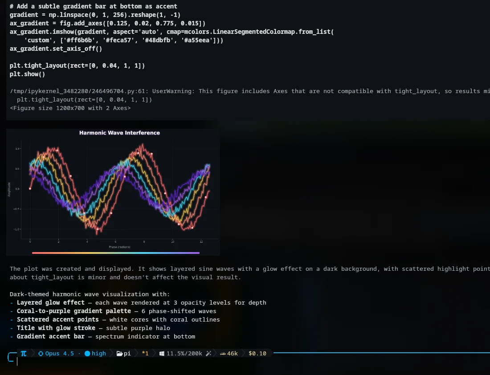
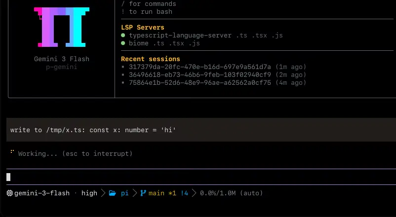
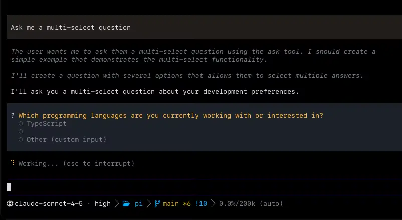

<p align="center">
  
</p>

<p align="center">
  <strong>一个内置 IDE 能力的编程智能体。</strong>
  <strong><a href="https://omp.sh">omp.sh</a></strong>
</p>

<p align="center">
  Language: <a href="README.md">English</a> | <strong>简体中文</strong>
</p>

<p align="center">
  <a href="https://www.npmjs.com/package/@oh-my-pi/pi-coding-agent"></a>
  <a href="https://github.com/can1357/oh-my-pi/blob/main/packages/coding-agent/CHANGELOG.md"></a>
  <a href="https://github.com/can1357/oh-my-pi/actions"></a>
  <a href="https://github.com/can1357/oh-my-pi/blob/main/LICENSE"></a>
  <a href="https://www.typescriptlang.org"></a>
  <a href="https://www.rust-lang.org"></a>
  <a href="https://bun.sh"></a>
  <a href="https://discord.gg/4NMW9cdXZa"></a>
</p>

<p align="center">
  由 <a href="https://stencil.so">Stencil Labs</a> 打造 · 派生自 <a href="https://github.com/mariozechner">@mariozechner</a> 的 <a href="https://github.com/badlogic/pi-mono">Pi</a>
</p>

目前能力最强的编程智能体。在真实使用中持续打磨——开箱即用，从里到外完全开放。

**60+** 个模型提供商 · **31** 个内置工具 · **14** 种 LSP 操作 · **28** 种 DAP 操作 · **约 8 万**行 Rust 核心代码。

> [!NOTE]
> Pull Request 目前**临时向所有人开放**，作为一次试行。此前我们要求 PR 必须先获得担保（vouch）才会被接受；在评估开放贡献效果期间，这一要求暂时取消。视结果而定，担保机制可能会恢复。

## 安装

**macOS · Linux**

```sh
curl -fsSL https://omp.sh/install | sh
```

如果没有可用的 bun（或指定了 `--binary`），安装脚本会从 `build.stencil.so` 下载预编译二进制，并在安装前校验其 SHA-256。可通过 `curl -fsSL https://omp.sh/install | sh -s -- --binary --ref v<version>` 固定某个版本（PowerShell：`-Binary -Ref v<version>`）。

> **Alpine / musl：** 预编译的 musl 二进制动态链接 `libstdc++`/`libgcc`，而原生 Alpine 并不自带。请先安装：`apk add libstdc++ libgcc`。

**Homebrew**

```sh
brew install can1357/tap/omp
```

**Bun（推荐）**

```sh
bun install -g @oh-my-pi/pi-coding-agent
```

**Nix**

```sh
# Run without installing
nix run github:can1357/oh-my-pi

# Or install into the active profile (Nix < 2.30: `nix profile install`)
nix profile add github:can1357/oh-my-pi
```

Flake 使用者可以使用 `packages.<system>.omp`、`overlays.default`、`nixosModules.default` 或 `homeManagerModules.default`。Home Manager 配置可以安装 OMP 并以声明式方式管理其设置：

```nix
{
  inputs.omp.url = "github:can1357/oh-my-pi";

  # In your Home Manager module:
  imports = [ inputs.omp.homeManagerModules.default ];
  programs.omp = {
    enable = true;
    settings.startup.quiet = true;
  };
}
```

**Windows（PowerShell）**

```powershell
irm https://omp.sh/install.ps1 | iex
```

**固定版本（mise）**

```sh
mise use -g github:can1357/oh-my-pi
```

macOS · Linux · Windows · bun ≥ 1.4.4

### Shell 补全

`omp` 会根据实时的命令/参数元数据，为 **bash**、**zsh** 和 **fish** 生成自己的补全脚本，因此永远不会与实际 CLI 脱节。子命令、参数和枚举值是静态补全的；模型名（`--model`、`--smol`、`--slow`、`--plan`）会根据内置模型目录解析，`--resume` 则根据磁盘上的会话解析。

```sh
# zsh — add to ~/.zshrc (or write the output into a file on your $fpath)
eval "$(omp completions zsh)"

# bash — add to ~/.bashrc
eval "$(omp completions bash)"

# fish
omp completions fish > ~/.config/fish/completions/omp.fish
```

## 每个工具，都 _调校到极致_。

编辑一次成功。读取时给出文件摘要，而不是把整个文件倒出来。搜索即时返回。无论选哪个模型，omp 都能让它把事做好。

| 模型             | 指标         | 说明                                                 |
| ---------------- | ------------ | ---------------------------------------------------- |
| Grok Code Fast 1 | 6.7% → 68.3% | 编辑格式不再拖垮模型的那一刻，成功率提升十倍。       |
| Gemini 3 Flash   | +5 pp        | 优于 str_replace——超过了 Google 自己在该格式上的最佳成绩。 |
| Grok 4 Fast      | −61% tokens  | 不再因错误 diff 反复重试，输出量大幅下降。           |
| MiniMax          | 2.1×         | 通过率翻倍有余。同样的权重，同样的提示词。           |

- `read`：摘要片段 · 合理的默认值 · 选择器命中率
- `grep`：快到没有对手
- `lsp`：IDE 知道的一切，智能体都知道
- `prompts`：针对每个模型持续调整

[阅读完整文章 ↗](https://blog.can.ac/2026/02/12/the-harness-problem/)

## 你 _喜爱_ 的 Pi，如今**全副武装**。

omp 最初基于 [Mario Zechner](https://github.com/mariozechner) 出色的 [Pi](https://github.com/badlogic/pi-mono) 构建，补齐了你所缺少的一切。

### 01 · 可调用工具的代码执行

大多数智能体框架给智能体一个 Python 沙箱就算完事。我们运行持久化的 Python 和 Bun worker，而且两个内核都能通过本地回环桥接回调智能体自己的工具——read、search、task。智能体可以在 Python 里用 tool.read 加载 CSV，再用 JavaScript 绘图，全程不离开同一个单元格。



### 02 · 每次写入都接入 LSP

要求重命名，得到的就是真正的重命名。调用会走 workspace/willRenameFiles，因此在文件移动之前，重导出、barrel 文件和带别名的导入都会先被更新。IDE 知道的一切，智能体都知道。



_[阅读 LSP 配置文档](docs/lsp-config.md)_

### 03 · 驱动真正的调试器

C 程序段错误：智能体挂上 lldb，单步到出错的指针，读取栈帧。Go 服务卡死：挂上 dlv，逐个查看 goroutine。Python 进程卡住：debugpy、暂停、检查、求值。而大多数智能体还在到处加 print 调试。


_[观看录屏 ↗](https://omp.sh/clips/dap.mp4)_

### 04 · 时间回溯式流规则

规则平时处于休眠状态，直到模型开始跑偏。一旦正则匹配，就在 token 输出到一半时中止流，把规则作为系统提醒注入，并从同一位置重试。你获得了纠偏能力，却不用每一轮都为规则付出上下文开销。注入内容在上下文压缩后依然保留，修正会持续生效。


_[观看录屏 ↗](https://omp.sh/clips/ttsr.mp4)_

### 05 · 一等公民的子智能体

把任务拆给多个 worker，拿回带类型的结果。task 会把任务分发到相互隔离的 worktree，每个 worker 拥有自己的工具集，最终产出一个经过 schema 校验的对象，供父智能体直接读取。无需解析大段文字，并行的子智能体之间不会产生合并冲突，也不会留下没人管的修改。


_[观看录屏 ↗](https://omp.sh/clips/irc.mp4)_

在运行过程中随时查看各个子智能体：`Alt+A` 打开 [Agent Hub](docs/agent-hub.md)，列表中会显示每个子智能体的当前活动与用量。打开其中一个即可查看实时对话记录、发送引导消息、重新唤醒已挂起的 worker，或在不中止父会话的情况下结束卡住的那个。

### 06 · 第二个模型，盯着每一轮。

给 “advisor” 角色配一个审阅模型，它会读取主智能体的每一轮操作，并在行内插入注释——一句提醒、一个顾虑，或一个硬性阻断。它拥有独立的上下文和模型，因此能发现执行者匆忙略过的问题。主智能体看到注释后会纠偏，或者告诉你为什么不这么做。


_[观看录屏 ↗](https://omp.sh/clips/advisor.mp4)_

### 07 · 把链接发给别人，他们就进来了。

/collab 会把你的实时会话放到中继服务器上，并返回一个链接和二维码。队友可以在另一个终端用 omp join 加入，或者直接在浏览器中打开。以读写方式共享即可结对使用同一个智能体；/collab view 则生成只读链接，任何人都能观看但无法操控。数据帧在客户端加密，中继服务器永远拿不到你的密钥。


_[观看录屏 ↗](https://omp.sh/clips/collab.mp4)_

### 08 · 读一篇 arXiv 上的 PDF？有何不可。

web_search 串联了二十三个按优先级排列的搜索提供商，并把找到的 URL 直接交给 read。arXiv PDF、GitHub 页面、Stack Overflow 帖子都会以结构化 Markdown 返回，锚点完整保留——与处理本地文件使用同一套工具。引用、跟进、摘录，永远不会丢失出处。


_[观看录屏 ↗](https://omp.sh/clips/web.mp4)_

### 09 · 毫不妥协的原生实现，Windows 上也一样。

其他智能体会调用外部的 rg、grep、find 和 bash。很多机器上根本没有这些程序；即便有，每次调用也要付出一次 fork-exec 的往返开销。omp 把真正的实现直接链接进进程：ripgrep、glob、find 全部在进程内运行。brush 就是 bash——会话可跨调用保持，58 个命令行工具（ls、sed、sort、xargs，甚至 jq）被移植进 builtins crate 并在进程内运行，零 fork/exec。同一个 omp 二进制可运行于 macOS、Linux 和 Windows——无需 WSL 桥接。

### 10 · 带优先级和结论的代码评审

明确告诉你这次改动能否发布，每个问题按 P0 到 P3 排序并给出置信度评分。/review 会派生专门的评审子智能体，并行审查分支、单个提交或未提交的修改。你先处理阻碍发布的问题；重要内容不会淹没在大段文字里。

想自己主导评审？`/annotate code-review` 会打开 diff，让你在评审者运行前把批注钉在具体行上。`/annotate` 还可以针对最新回复、某条会话消息、某个文件或引用文本，把你的批注粘贴进提示词。参见 [`/annotate`](docs/slash-command-internals.md#12-bundled-command-note-annotate)。

### 11 · Hashline：基于内容哈希编辑

编辑精准，token 更省。模型只需指向锚点，而不必重新输入要修改的行，因此空白字符对不上、反复报 “string not found” 这类问题都不会再出现。如果文件已经被改过，锚点就会对不上——我们会在补丁破坏任何内容之前拒绝它。完成同样的工作，Grok 4 Fast 的输出 token 减少了 61%。

### 12 · GitHub 只是另一个文件系统

其他智能体框架会额外加上 gh_issue_view、gh_pr_view、gh_search——每个都有自己的参数，智能体得去学，你得去调试。我们没这么做。read 本来就处理路径，而 PR 也是路径。模型只需学会一种接口，我们也只需维护好一套工具。

### 13 · 由智能体自己整理的记忆

智能体会在会话之间记住你的代码库。它在运行中用 retain 写下事实，用 learn 记录可复用的经验，用 recall 取回它们，并把每个会话压缩成一个心智模型，在下个会话的第一轮加载。用 `memory.backend` 选择引擎——local、Hindsight 或 Mnemopi。默认按项目作用域隔离，因此它对这个仓库学到的东西只留在这个仓库。

### 14 · ACP：可由编辑器驱动的智能体

在 Zed 中运行 omp，你得到的就是在终端里使用的同一个智能体——读取你正在看的缓冲区，通过编辑器自身的保存流程写入，在编辑器的终端里启动 shell。有破坏性的工具会先暂停并弹出权限提示，确认一次即可。无需桥接，无需插件，也不用额外维护一套需要来回同步的智能体。

### 15 · 继承你其他工具已经写好的配置

其他智能体都附带一个导入器，指望你去转换。omp 直接以原生格式读取磁盘上已有的八种格式——Cursor MDC、Cline .clinerules、Codex AGENTS.md、Copilot applyTo 等等。没有迁移脚本，没有 YAML 转 TOML，也没有“仅支持部分功能”的脚注。团队上个季度写的配置，今晚照样能用。

### 16 · omp commit：原子拆分，校验过的提交信息

omp 通过 git_overview、git_file_diff 和 git_hunk 读取工作区，然后把不相关的修改拆分成原子提交，并按依赖关系排序。存在循环依赖时会在写入任何内容前拒绝。源代码文件的权重高于测试、文档和配置，因此首个提交就是最重要的那个。锁文件完全不参与分析。

### 17 · 读 PR。_遍历技能。_ 从子智能体中提取 JSON。

十六种内部协议——`pr://`、`issue://`、`agent://`、`skill://`、`ssh://` 等——在智能体已经在用的所有文件系统类工具中透明解析。`read pr://1428` 返回的结构与 `read src/foo.ts` 相同。`grep` 可以像遍历目录一样遍历 diff。`agent://<id>/findings.0.path` 可按路径从子智能体的输出中取出某个字段。

### 18 · 冲突解决，轻而易举。

每个合并冲突都对应一个 URL。智能体向 `conflict://N` 写入 `@theirs`、`@ours` 或 `@base`，冲突就干净利落地解决了。批量处理用 `conflict://*`。


_[观看录屏 ↗](https://omp.sh/clips/conflict.mp4)_

### 19 · 先预览，再接受。

`ast_edit` 会返回一张带替换数量的 _（proposed）_ 卡片，修改处于暂存状态。智能体向 `xd://resolve` 写入一行理由；TUI 将其变为 **Accept** 卡片，随后才真正写入磁盘——原子操作，要么全部成功，要么全部不做。


_[观看录屏 ↗](https://omp.sh/clips/codemod.mp4)_

### 20 · 驱动 _真正的浏览器_。_甚至是你的 Slack？_

Eval 的 `browser.open(...)` 会返回一个标签页句柄，提供直接导航、检查、交互和元素辅助方法；`tab.run(...)` 用于执行自定义 JavaScript。它在隔离的标签页运行时中驱动 Chromium 或 Electron。默认开启反检测（stealth）模式；借助浏览器中继，还可以接管你已经打开的 Chrome 标签页，且不会抢走窗口焦点。

### 21 · 直接操作桌面

Eval 的 `computer` 辅助方法——`computer.window(...)`、`win.screenshot()`、`win.ax()`、`el.press()`，以及用于多步脚本的 `computer.run(fnOrCode, options)`——控制真实的宿主机：枚举窗口和显示器、截图、发送原生输入、遍历操作系统无障碍树、使用剪贴板。它不暴露浏览器 DOM。

## 任务需要什么，_早已内置_。

核心工具与 `read` 和 `bash` 位于同一命名空间。用 `--tools read,edit,bash,…` 固定启用的工具集；不常用的工具则通过 `xd://` 设备按需发现。`read xd://` 会列出它们，启用 `tools.xdev` 后可用 `write xd://<tool>` 运行。

**文件与搜索**

- `read` — 通过同一种路径读取文件、目录、压缩包、SQLite、PDF、notebook、URL、远程 `ssh://` 路径以及内部 `://` 协议。
- `write` — 创建或覆盖文件、压缩包条目或 SQLite 行。
- `edit` — 基于内容哈希锚点的 hashline 补丁，支持过期锚点恢复。
- `ast_edit` — 基于 ast-grep 的结构化重写，应用前可预览。
- `ast_grep` — 基于 50+ 种 tree-sitter 语法的结构化代码查询。
- `grep` — 对文件、glob 和内部 URL 进行正则搜索。
- `glob` — 基于 glob 的路径查找；需要匹配内容时请用 `grep`。

**运行时**

- `bash` — 工作区 shell，内置 46 个进程内 coreutils，可选 PTY，支持后台任务调度。
- `eval` — 持久化的 Python 和 JavaScript 单元格，共享预置环境并可回调工具。

**代码智能**

- `lsp` — 诊断、导航、符号、重命名、代码操作、原始请求。
- `debug` — 驱动 DAP 会话——断点、单步、线程、调用栈、变量。
- `security_scan` — 规划并运行原生安全审查；可驱动 Codex Security 云端扫描。

**协作调度**

- `task` — 并行扇出子智能体，可选工作区隔离。
- `wait` — 阻塞直到下一个后台结果、同伴消息或引导中断；通过 `agent://` 和 `proc://` 给同伴发消息、控制任务。
- `todo` — 对会话待办列表进行有序修改，支持阶段跟踪。
- `ask` — 交互式运行中的结构化追问。

**桌面与网络**

- `browser` — 基于 Puppeteer 的标签页，可用于无头 Chromium、通过 CDP 连接的应用，或经由中继的你自己的 Chrome。
- `computer` — 针对宿主桌面的持久化 JS：窗口、截图、原生输入、AX 树、剪贴板。
- `web_search` — 一次查询覆盖所有已配置的提供商，返回答案和引用。
- `github` — GitHub CLI 操作——仓库、PR、issue、代码搜索、Actions 运行监视。
- `generate_image` — 通过 Gemini、GPT 或 xAI Grok 图像模型生成或编辑位图。
- `tts` — 通过 xAI Grok Voice 进行文本转语音——五种内置音色，支持 WAV 或 MP3。

**记忆与技能**

- `checkpoint` — 标记对话状态，以便稍后折叠并汇报。
- `rewind` — 剪除探索性上下文，只保留简洁的报告。
- `retain` — 把持久事实加入当前记忆库的队列。
- `recall` — 在记忆库中搜索原始记忆。
- `reflect` — 基于记忆库综合出一个答案。
- `memory_edit` — 按 id 更新、遗忘或作废已存储的记忆。
- `learn` — 记录一条可复用的经验；可选择将其提升为托管技能。
- `manage_skill` — 创建、更新或删除一个独立的托管技能。

需在设置中开启、默认关闭的工具：`github`、`security_scan`、`generate_image`、`tts`、`checkpoint`、`rewind`，以及记忆工具（`retain`/`recall`/`reflect`/`memory_edit`，取决于 `memory.backend`）。

[完整参考 →](https://omp.sh/docs/tools)

### 提示词控制

三个独立的小写单词可以让某一轮启用特定的智能体行为：

- `ultrathink` — 要求进行仔细的多步推理，并使用支持的最高自动思考强度。
- `orchestrate` — 通过并行子智能体完成大量相互独立的工作，并逐阶段验证。
- `workflowz` — 使用当前的 `task` 工具构建确定性的多子智能体工作流。

它们只在普通文字中触发，不会在代码片段、围栏代码块、XML/HTML 区块、标识符或路径中触发。精确的匹配规则和配置见 [Magic keywords](docs/magic-keywords.md)。

### 会话控制

斜杠命令会改变整个会话的运行方式：

- `/vibe` — 进入 [Vibe 模式](docs/vibe-mode.md)：以导演身份驱动持久化的 `fast`/`good` worker 会话，自身仅使用 `read` 工具集。
- `/fresh` — 重置提供商的流状态（过期的提示缓存、卡住的流），不改变本地对话记录。参见 [Session operations](docs/session-operations-export-share-fork-resume.md#fresh)。

## 六十多个提供商、上千个模型，_只需一次 /model_。

九种角色按用途分配模型。`default` 用于常规对话；`smol` 用于低成本地批量派发子智能体；`slow` 用于深度推理；`plan` 用于计划模式；`commit` 用于生成变更日志；此外还有 `vision`、`task`、`advisor` 和 `tiny`，各司其职。启动时可用 `--smol`、`--slow` 或 `--plan` 覆盖；用 `Ctrl+P` 在当前角色已配置的模型间循环切换。会话中可用 `/model` 斜杠命令切换当前模型。

下文的认证标签：`oauth` 表示用你在该提供商的账号登录，`plan` 表示通过编程套餐订阅使用，`local` 表示连接本地服务器，密钥可选。

### 前沿 API

直连 API 和网关。可按角色混用不同提供商。

Anthropic `oauth` · OpenAI · OpenAI Codex `oauth` · Google Gemini · Google Vertex · Google Antigravity `oauth` · xAI · SuperGrok `oauth` · DeepSeek · Mistral · Groq · Cerebras · SambaNova · Fireworks · Together · Baseten · DeepInfra · Hugging Face · NVIDIA · Meta · Inception · Amazon Bedrock · Azure OpenAI · SiliconFlow · GMI Cloud · CoreWeave · Sakana AI · Command Code · Charm Hyper · StepFun · Helmcode · OpenRouter · Synthetic · Vercel AI Gateway · Cloudflare AI Gateway · Wafer Serverless

### 编程套餐

走订阅额度。用 `/login` 登录后即可在会话中使用。

Cursor `oauth` · GitHub Copilot `oauth` · GitLab Duo · Devin `oauth` · Kimi Code `plan` · Moonshot · MiniMax Coding Plan `plan` · MiniMax Coding Plan CN `plan` · Alibaba Coding Plan `plan` · Qwen Portal `oauth` · Z.AI / GLM Coding Plan `plan` · Zhipu Coding Plan `plan` · Xiaomi MiMo · Qianfan · Umans `plan` · NanoGPT · Novita · Venice · Kilo · ZenMux · OpenCode Go · OpenCode Zen

### 本地部署

兼容 OpenAI 的 `/v1/models`。本地实例无需密钥。

Ollama `local` · Ollama Cloud · LM Studio `local` · llama.cpp `local` · vLLM `local` · LiteLLM

### 自定义 OpenAI 兼容提供商

在 `~/.omp/agent/models.yml` 中定义自定义提供商：

```yaml
providers:
   spark:
      baseUrl: http://192.168.10.223:8000/v1
      api: openai-completions
      apiKey: dummy
      models:
         - id: minimax-m3
           name: MiniMax M3
           contextWindow: 100000
           maxTokens: 32000
```

运行 `omp models spark` 确认能发现该提供商的模型。然后运行 `omp setup` 并在选择默认模型的步骤中选中它，或在会话中打开 `/model` 将其分配给 `default` 角色。

如果不想通过选择器，也可以直接在 `~/.omp/agent/config.yml` 中预先配置默认模型：

```yaml
modelRoles:
   default: spark/minimax-m3
```

### 让路由真正好用的四个开关

- **自定义提供商** — 在 `~/.omp/agent/models.yml` 中声明任何支持以下协议的服务：`openai-completions`、`openai-responses`、`openai-codex-responses`、`azure-openai-responses`、`anthropic-messages`、`bedrock-converse-stream`、`google-generative-ai`、`google-gemini-cli`、`google-vertex`、`typesafe`、`openrouter-decisions`、`openai-decisions` 或 `workers-ai-systemone`（后几个为评判类 API）。
- **回退链** — 在 `retry.fallbackChains` 下按角色或按模型配置回退链。当主模型返回 429 或触及配额上限时，链中下一项接管本轮剩余部分——冷却后自动恢复。
- **按路径限定模型** — 给 `enabledModels` 和 `disabledProviders` 条目加上 `path:` 前缀，即可在某个仓库固定一组不同的模型，而无需改动全局配置。限定条目覆盖该路径及其下所有内容。
- **轮换凭据** — 为每个提供商叠加多个 API 密钥，运行时会按会话亲和性轮换，并对每个凭据单独退避。适合一个密钥中午前就会把配额烧光的情况。

完整的提供商与路由参考见 [omp.sh/docs/providers](https://omp.sh/docs/providers)。

## 二十三个后端。_智能体早已用惯的一个工具_。

`web_search` 是内置的，而不是外挂的。`auto` 会依次尝试二十三个提供商；如果你已经付费订阅了某一个，也可以按名称固定使用。每个搜索结果背后，站点感知的提取器会把 GitHub、包注册表、arXiv、Stack Overflow 和文档站点转换为结构化 Markdown——锚点和链接目标都会保留。

### 搜索提供商

二十三个后端。固定使用其中之一，或让 `auto` 按顺序依次尝试。

| 提供商       | 认证方式                                  |
| ------------ | ----------------------------------------- |
| `auto`       | 按顺序依次尝试                            |
| `perplexity` | `PERPLEXITY_API_KEY`（可匿名回退）        |
| `gemini`     | oauth                                     |
| `anthropic`  | oauth                                     |
| `codex`      | oauth                                     |
| `xai`        | oauth 或 `XAI_API_KEY`                    |
| `zai`        | `ZAI_API_KEY`                             |
| `exa`        | `EXA_API_KEY`（或 mcp）                   |
| `tinyfish`   | `TINYFISH_API_KEY`                        |
| `jina`       | `JINA_API_KEY`                            |
| `kagi`       | `KAGI_API_KEY`                            |
| `tavily`     | `TAVILY_API_KEY`                          |
| `firecrawl`  | `FIRECRAWL_API_KEY`（可无密钥回退）       |
| `brave`      | `BRAVE_API_KEY`                           |
| `kimi`       | `/login kimi-code` 或搜索密钥             |
| `parallel`   | `PARALLEL_API_KEY`                        |
| `synthetic`  | `SYNTHETIC_API_KEY`                       |
| `searxng`    | 自托管                                    |
| `duckduckgo` | 无需密钥                                  |
| `startpage`  | 无需密钥                                  |
| `google`     | 无需密钥（浏览器）                        |
| `ecosia`     | 无需密钥（浏览器）                        |
| `mojeek`     | 无需密钥（浏览器）                        |
| `public`     | 无需密钥（整合以上所有）                  |

Exa 也可以通过 `/login exa` 存储 API 密钥；显式选择无密钥模式时使用公共 MCP 回退。

### 专用处理器

智能体拿到的是结构化内容，而不是剥掉标签后的一堆 HTML 文本。

- **代码托管** — github、gitlab
- **包注册表** — npm、PyPI、crates.io、Hex、Hackage、NuGet、Maven、RubyGems、Packagist、pub.dev、Go packages
- **学术来源** — arxiv、semantic scholar
- **论坛** — stack overflow、reddit、hn
- **文档** — mdn、readthedocs、docs.rs

页面会被转换为保留链接结构的 Markdown。智能体可以引用、跟进和摘录，而不会丢失锚点。

### 安全数据库

漏洞查询返回的是官方数据，而不是博客摘要。

- **NVD** — 美国国家漏洞数据库
- **OSV** — 开源漏洞数据源
- **CISA KEV** — 已知被利用漏洞目录

[`web_search` 参考 ↗](https://omp.sh/docs/tools#web_search)

## 约 **80,000** 行 Rust，干的是其他智能体框架要调用外部程序才能做的活。

六个 crate，一个按平台打包的 N-API 插件。搜索、shell、AST、语法高亮、PTY、桌面控制、图像解码、BPE 计数——全部在 libuv 线程池中进程内完成。热路径上没有 fork/exec。另外还内置了约 8 万行第三方代码：brush 的 bash 分支，以及 58 个命令行工具——coreutils、findutils、sed、jq、基于 ripgrep 的 grep、fd、diff、moreutils——它们被移植进 builtins crate，直接编译进 shell。

- Crate：`pi-natives`、`pi-shell`、`pi-ast`、`pi-iso`、`pi-voice`、`pi-walker`
- 平台：`linux-x64`、`linux-arm64`、`darwin-x64`、`darwin-arm64`、`win32-x64`、`win32-arm64`——x64 同时提供 AVX2 和基线两种二进制

按 crate 统计（仅代码行）：

| Crate      | 功能                                                                         | ~代码行 |
| ---------- | ---------------------------------------------------------------------------- | ------: |
| pi-shell   | 内嵌 bash 引擎 · 持久会话 · 进程内 coreutils 调度 · 输出精简器               |  38,000 |
| pi-natives | N-API 接口层——下表中的所有模块                                               |  25,000 |
| pi-walker  | 并行遍历器 · 目录列表缓存 · glob · 为 natives 和 shell 的 rg/grep/fd 提供正则搜索 | 11,400 |
| pi-iso     | 工作区隔离 · apfs · btrfs · zfs · reflink · overlayfs · projfs · rcopy        |   3,300 |
| pi-ast     | tree-sitter + ast-grep 匹配、代码块解析、结构化摘要                          |   2,900 |
| pi-voice   | 音频采集/播放 · Opus · 实时 WebRTC                                           |   1,000 |

`pi-natives` 内部的模块明细（省略胶水代码和测试）：

| 模块          | 功能                                                                  | 基于                                      | ~代码行 |
| ------------- | --------------------------------------------------------------------- | ----------------------------------------- | ------: |
| desktop       | 为 `computer` 提供窗口/显示器枚举 · 截图 · 原生输入 · AX 树           | xcap · enigo · OS AX FFI                  |  10,600 |
| grep          | 正则搜索 · 并行/串行 · glob 与类型过滤 · 模糊查找                     | grep-regex · grep-searcher                |   3,280 |
| text          | ANSI 感知的宽度计算 · 截断 · 按列切片 · 保留 SGR 的换行               | unicode-width · segmentation              |   2,070 |
| snapcompact   | 用于上下文压缩的位图帧光栅化 + PNG 编码                               | image · png                               |   1,760 |
| keys          | Kitty 键盘协议，带 xterm 回退 · PHF 完美哈希查找                      | phf                                       |   1,740 |
| ast           | ast-grep 模式匹配与结构化重写                                         | ast-grep-core                             |   1,510 |
| diff          | 为工具和预览提供结构化文件 diff                                       | 自研                                      |   1,030 |
| pty           | 为 sudo · ssh 交互式提示分配原生 PTY                                  | portable-pty                              |     630 |
| crash_handler | 原生崩溃捕获与上报                                                    | 自研                                      |     610 |
| highlight     | 语法高亮 · 11 种语义类别 · 30+ 个别名                                 | syntect                                   |     550 |
| appearance    | Mode 2031 + 通过 CoreFoundation FFI 实现 macOS 原生深色/浅色检测      | core-foundation                           |     450 |
| task          | 在 libuv 线程池上执行阻塞任务 · 取消 · 超时 · 性能分析                | tokio · napi                              |     440 |
| glob          | 基于 glob 的发现 · 类型过滤 · 按 mtime 排序 · 遵循 gitignore          | ignore · globset                          |     430 |
| fd            | 用于替代 find 工具的文件系统遍历器                                    | ignore                                    |     385 |
| clipboard     | 系统剪贴板的文本复制与图片读取 · 无需 xclip/pbcopy                    | arboard                                   |     370 |
| workspace     | 一次遍历完成 gitignore 处理和 AGENTS.md 发现的工作区遍历器            | ignore                                    |     275 |
| power         | 用于阻止空闲/系统/显示器休眠的 macOS 电源断言 API                     | IOKit FFI                                 |     270 |
| prof          | 环形缓冲区性能分析器，输出折叠栈和 SVG 火焰图                         | inferno                                   |     240 |
| file_lock     | 跨进程建议性文件锁                                                    | 自研                                      |     210 |
| ps            | 跨平台进程树终止与子孙进程列举                                        | libc · libproc · CreateToolhelp32Snapshot |     195 |
| tokens        | O200k / Cl100k BPE token 计数 · 两张表均已内嵌                        | tiktoken-rs                               |      70 |
| html          | HTML 转 Markdown，可选内容清理                                        | html-to-markdown-rs                       |      60 |
| sixel         | 终端图像渲染 · 解码 PNG · JPEG · WebP · GIF · 缩放 · SIXEL 编码       | icy_sixel · image                         |      55 |

## 四种入口：_交互式_、_单次执行_、RPC 和 ACP。

同一个引擎，四种封装。`omp` 运行 TUI。`omp -p` 回答单个提示后退出。Node SDK 把会话嵌入你的进程。`omp --mode rpc` 和 `omp acp` 通过 stdio 把控制权交给另一个程序。

### 交互式——拿不准时，智能体会问你

TUI 是默认界面。工具调用渲染为卡片，编辑在写入磁盘前可预览，遇到歧义时则通过 `ask` 工具处理——这是一个智能体可以在回合中途调用的结构化选项选择器。其余操作都可以用键盘完成。

同样的提示卡片也会通过 ACP 呈现，编辑器无需自己实现选择器。



### SDK——嵌入 Node

`@oh-my-pi/pi-coding-agent`

Node 和 TypeScript 宿主可以直接引入引擎。该包导出 `ModelRegistry`、`SessionManager`、`createAgentSession` 和 `discoverAuthStorage`；会话会发出带类型的事件供你订阅。

```ts
import { ModelRegistry, SessionManager, createAgentSession, discoverAuthStorage } from "@oh-my-pi/pi-coding-agent";

const auth = await discoverAuthStorage();
const models = new ModelRegistry(auth);
await models.refresh();

const { session } = await createAgentSession({
	sessionManager: SessionManager.inMemory(),
	authStorage: auth,
	modelRegistry: models,
});
await session.prompt("list .ts files");
```

### RPC——通过 stdio 驱动

`omp --mode rpc`

适用于非 Node 的嵌入方，或需要进程隔离的场景。输入 NDJSON 命令，输出响应帧和事件帧；每个提示以各自的 `prompt_result` 结束。`--mode rpc-ui` 会额外以 `extension_ui_request` 帧的形式发送工具卡片、选择器和对话框，宿主必须应答；`--no-ui` 则连扩展对话框也不会发送，适用于没有 UI 的宿主。

```
$ omp --mode rpc --no-session
> {"id":"r1","type":"prompt","message":"list .ts files"}
< {"id":"r1","type":"response", ...}
> {"id":"r2","type":"set_model","provider":"anthropic","modelId":"sonnet-4.5"}
> {"id":"r3","type":"abort"}
```

### ACP——与编辑器对话

`omp acp`

基于 JSON-RPC 的 [Agent Client Protocol](https://github.com/zed-industries/agent-client-protocol)。当编辑器声明了相应能力时，工具 I/O 会经由编辑器路由，写入操作需通过 `session/request_permission` 授权。

| omp 工具     | ACP 路由                            |
| ------------ | ----------------------------------- |
| `bash`       | `terminal/create + terminal/output` |
| `read`       | `fs/read_text_file`                 |
| `write`      | `fs/write_text_file`                |
| `edit, bash` | `session/request_permission`        |

完整参考：[omp.sh/docs/sdk](https://omp.sh/docs/sdk)。

## 值得长期使用的智能体框架，是你 _永远_ 不会嫌它不够用的那一个。

前往 **[omp.sh](https://omp.sh)** 获取。

omp 派生自 [Mario Zechner](https://github.com/mariozechner) 的 [Pi](https://github.com/badlogic/pi-mono)，并被重写为专注编程的智能体：会话、子智能体、斜杠命令、扩展——全部用 TypeScript 编写，全部采用 MIT 许可，全部开源在 [GitHub](https://github.com/can1357/oh-my-pi) 上。你可以通过配置定制它，从外部用钩子接入它，必要时直接阅读源码。

### 基本构件

扩展就是一个 TypeScript 模块。它与内置功能使用相同的工具 API、相同的斜杠命令注册表、相同的快捷键表和相同的 TUI 构件。没有哪项能力是内置功能独享的。

### 自动发现

首次运行时，omp 会继承磁盘上已有的一切：来自 `.claude`、`.cursor`、`.windsurf`、`.gemini`、`.codex`、`.cline`、`.github/copilot` 和 `.vscode` 的规则、技能和 MCP 服务器。无需迁移脚本。

### 可扩展性

让 omp 写出你缺少的那部分，然后执行 `/reload-plugins`。可以只留在本地，也可以放进 `marketplace` 分发，或发布到 npm。

## 理念

omp 派生自 [Mario Zechner](https://github.com/mariozechner) 的 [pi-mono](https://github.com/badlogic/pi-mono)，并扩展为功能齐全的编程工作流。

核心理念：

- 为真实的编程工作保留以终端为先的交互体验
- 内置实用功能（工具、会话、分支、子智能体、可扩展性）
- 让高级行为可配置，而不是隐藏起来

### 项目输入与信任

打开一个仓库时，omp 会按设计加载该项目自带的输入：设置、扩展、钩子、工具、命令、技能、规则以及项目级 MCP 配置。若只想在某次运行中排除项目的 `.mcp.json`，可传入 `--config <file>`，指向一个使用嵌套键的 YAML 覆盖文件（扁平写法 `mcp.enableProjectConfig: false` 会被忽略）：

```yaml
mcp:
   enableProjectConfig: false
```

使用 `--no-extensions` 跳过自动的扩展发现；或使用 `--trusted-extension /absolute/path/to/file.ts` 指定精确的扩展白名单。`--no-tools` 会禁用内置工具，但项目工具模块属于另一个独立的发现来源。这些参数只会收窄输入范围，不会改变仓库信任模型。

---

## 开发

### 从源码开始

全新克隆的仓库需要先安装工作区依赖并构建本地 Rust/N-API 插件，源码版 CLI 才能启动。

```sh
bun setup
bun dev
```

`bun setup` 会安装 Bun 工作区依赖并构建 `@oh-my-pi/pi-natives`。修改 Rust crate 或 `packages/natives` 后，请重新运行 `bun run build:native`。

Nix 用户可以获得固定版本的 Bun 和 Rust 工具链以及所有原生构建依赖：

```sh
nix develop
bun setup
bun dev
```

使用 `nix build .#omp` 构建并冒烟测试可分发的 Nix 包。Wayland 屏幕录制支持默认关闭（链接 libpipewire 会增加约 750 MB 的运行时闭包）；可通过 `omp.override { withWaylandScreencast = true; }` 开启。发布构建使用 fat LTO 链接 `pi-natives`；`omp.override { withFatLto = false; }` 改用 thin LTO，本地重新构建会快得多。Rust 依赖和原生插件在不同的 derivation 中构建，因此修改 Rust 代码会复用已编译的依赖，修改 TypeScript 会复用已构建的插件。`nix/bun.nix` 只在 `bun.lock` 变化时生成；发布时会自动重新生成。依赖变更后，请运行：

```sh
bun run gen:nix
```

该命令会优先使用 `nix develop` 中的 `bun2nix`；若不可用，则通过 Nix 进入开发 shell，最后回退到固定版本的 `bunx bun2nix@2.1.2`。请勿手动编辑 `nix/bun.nix`。

非交互式冒烟检查：

```sh
bun dev -- --version
```

### 调试命令

`/debug` 会打开用于调试、上报和性能分析的工具。

架构说明和贡献指南见 [packages/coding-agent/DEVELOPMENT.md](packages/coding-agent/DEVELOPMENT.md)。

---

## Monorepo 包

| 包                                                                            | 说明                                                       |
| ----------------------------------------------------------------------------- | ---------------------------------------------------------- |
| **[@oh-my-pi/collab-web](packages/collab-web)**                               | 协作实时会话的浏览器访客客户端、模拟宿主和本地中继         |
| **[@oh-my-pi/pi-ai](packages/ai)**                                            | 支持流式输出和模型/提供商集成的多提供商 LLM 客户端         |
| **[@oh-my-pi/pi-catalog](packages/catalog)**                                  | 模型目录：内置模型数据库、提供商描述符和模型身份识别       |
| **[@oh-my-pi/pi-agent-core](packages/agent)**                                 | 支持工具调用和状态管理的智能体运行时                       |
| **[@oh-my-pi/pi-coding-agent](packages/coding-agent)**                        | 交互式编程智能体 CLI 和 SDK                                |
| **[@oh-my-pi/pi-tui](packages/tui)**                                          | 支持差分渲染的终端 UI 库                                   |
| **[@oh-my-pi/pi-natives](packages/natives)**                                  | 用于 grep、shell、图像、文本、语法高亮等功能的 N-API 绑定  |
| **[@oh-my-pi/omp-stats](packages/stats)**                                     | AI 使用统计的本地可观测性面板                              |
| **[@oh-my-pi/omptype](packages/omptype)**                                     | 兼容 ArkType、带惰性 JIT 编译的 schema 校验库              |
| **[@oh-my-pi/pi-utils](packages/utils)**                                      | 共享工具库（日志、流、目录/环境/进程辅助函数）             |
| **[@oh-my-pi/pi-wire](packages/wire)**                                        | 协作实时会话共享的协议类型和中继常量                       |
| **[@oh-my-pi/pi-mnemopi](packages/mnemopi)**                                  | 面向 omp 智能体的本地 SQLite 记忆引擎                      |
| **[@oh-my-pi/snapcompact](packages/snapcompact)**                             | 位图帧上下文压缩包及 SQuAD 评测套件                        |
| **[@oh-my-pi/browser-relay](packages/browser-relay)**                         | 让 Eval 浏览器 API 驱动你现有标签页的 Chrome 扩展          |
| **[@oh-my-pi/pi-metaharness](packages/metaharness)**                          | 统一的基准测试运行器、Harbor 运行存储、REST/SSE API、实时面板 |
| **[@oh-my-pi/typescript-edit-benchmark](packages/typescript-edit-benchmark)** | 基于 TypeScript 源码变异构建的编辑基准测试套件             |

### Rust Crate

| Crate                                      | 说明                                                                                     |
| ------------------------------------------ | ---------------------------------------------------------------------------------------- |
| **[pi-natives](crates/pi-natives)**        | `@oh-my-pi/pi-natives` 使用的核心 Rust 原生插件（N-API `cdylib`）；聚合下列各 crate      |
| **[pi-shell](crates/pi-shell)**            | 从 `pi-natives` 拆分出的内嵌 shell / PTY / 进程管理（封装 `brush-*`）                    |
| **[pi-ast](crates/pi-ast)**                | 基于 tree-sitter 的代码摘要器和 AST 工具（50+ 种语言语法）                               |
| **[pi-iso](crates/pi-iso)**                | 任务隔离后端解析器：APFS 克隆、btrfs/zfs reflink、overlayfs、projfs、rcopy               |
| **[pi-voice](crates/pi-voice)**            | 音频采集/播放、Opus 编解码和实时 WebRTC 流式传输基础组件                                 |
| **[pi-walker](crates/pi-walker)**          | 为 natives 和 shell 提供并行的 ignore 感知遍历器、目录列表缓存、glob 和内容搜索          |
| **[pi-edit](crates/pi-edit)**              | `edit` 工具背后的编辑引擎：基于行锚点的 patch/hashline 模式、流式预览、原子化应用        |
| **[brush-core](crates/vendor/brush-core)** | 内置（vendored）的 [brush-shell](https://github.com/reubeno/brush) 分支，用于内嵌执行 bash |
| **[pi-builtins](crates/pi-builtins)**      | Bash 内建命令（cd、echo、test、printf、read、export……）以及 67 个进程内命令行工具        |

## 参与贡献

Issue 和 Pull Request 向所有人开放。开放 PR 目前处于**试行**阶段——在评估效果期间暂时取消了此前的担保（vouch）要求，之后可能会恢复。贡献指南请参阅 **[CONTRIBUTING.md](CONTRIBUTING.md)**。

---

## 许可证

OMP 基于 [MIT 许可证](LICENSE) 发布。

第三方代码和内置（vendored）的上游代码，包括 `crates/vendor/brush-core` 以及 `crates/pi-builtins/LICENSE` 中标明的第三方部分，仍遵循各自上游的许可证。每个发布的组件都附带自己的 `THIRD-PARTY-NOTICES.txt`：CLI（`packages/coding-agent`）、原生插件（`packages/natives`）和 robomp（`python/robomp`）。`omp --license` 会打印 CLI 和原生插件的许可声明。

© 2025 Mario Zechner  
© 2025-2026 Can Bölük  
© 2026 [Stencil Labs, Inc.](https://stencil.so)

_为常开的终端而生_

- [omp.sh](https://omp.sh)
- [Stencil Labs](https://stencil.so)
- [GitHub](https://github.com/can1357/oh-my-pi)
- [变更日志](https://github.com/can1357/oh-my-pi/blob/main/packages/coding-agent/CHANGELOG.md)
- [npm](https://www.npmjs.com/package/@oh-my-pi/pi-coding-agent)
- [Discord](https://discord.gg/4NMW9cdXZa)
- [MIT](https://github.com/can1357/oh-my-pi/blob/main/LICENSE)
