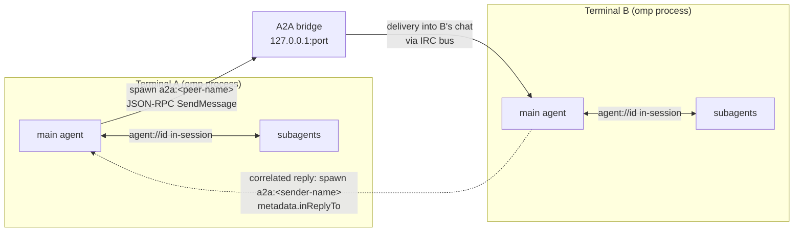

# A2A inter-terminal agent networking

> Every omp process serves an Agent2Agent v1.0 bridge on `127.0.0.1`, so
> sessions running in separate terminals discover each other, address each
> other's agents by name, and exchange tasks and replies over JSON-RPC 2.0.

## What it is

The unit of communication is a *terminal*: one omp process (usually one
interactive session). Two mechanisms cover all agent-to-agent traffic:

- **In-session peer messaging** — subagents inside one omp process message each
  other directly through `write agent://<id>` over the IRC bus (rate, dedup, and
  hop limits guard it). `write agent://` reaches **local** session agents only.
  See [Agent Hub](./agent-hub.md) for the roster UI.
- **Inter-terminal A2A** — agents in *different processes* reach each other
  through each terminal's A2A bridge: the local loopback server exposing the
  Agent2Agent protocol (agent card at `/.well-known/agent-card.json`, JSON-RPC
  2.0 over HTTP, optional SSE task streaming), plus a client that registers peer
  bridges and spawns their agents through the task tool.



The A2A protocol is only served on the loopback interface; a bridge never
accepts connections from other hosts, and every request must present the
bearer token. Terminals sharing one profile share the token file, which is
what makes the zero-config auto-registration below work.

## Quick start

Nothing to enable: `a2a.enabled` is on by default and `a2a.port: 0` picks a
free ephemeral port per terminal. With `a2a.autoRegister` enabled, each
terminal registers live peers at session start and discovers later terminals
on demand:

1. Terminal A and terminal B each run `omp`. With no `--a2a-name` and an
   empty `a2a.name`, each gets a unique auto name `<slug(basename(cwd))>-<pid>`
   (skill-id-safe); with `--a2a-name` / `a2a.name`, that configured name is used instead. There is no default
   `Main` name.
2. In A, ask the agent to spawn a peer's main agent by its `a2a:` name, e.g.
   "spawn `a2a:<B's name>` with the prompt: what are you working on?".
3. The task travels to B and lands in the addressed agent's conversation. A
   successful delivery returns a receipt and a running reply-job ID, not the
   answer. Use `wait` on that job to receive the correlated reply.
   The addressed agent can explicitly reply by spawning `a2a:<sender>` with
   the task tool; otherwise Main can relay its final text, and a subagent can
   relay its wake-turn published output or final text. Claiming a request is
   temporary: it is confirmed only when the reply send succeeds and released
   otherwise, so failed, aborted, or empty turns leave the request open for an
   explicit reply. A worker lost with an unacknowledged claim reopens exactly
   its requests; no exactly-once delivery across network or acknowledgement
   failure is promised. The process-wide incoming ledger covers Main,
   subagents, and worker links; only the addressed agent can claim its request.
   Automatic relays atomically claim before sending detached, so remote
   transport does not hold up turn settlement. An automatic relay only sends to
   the endpoint the request came from: the sender's `fromUrl` must match a
   registered peer, and a legacy request without one needs exactly one
   same-skill candidate — otherwise the reply waits for a manual `a2a:<name>`
   spawn (see below).

Terminals that start later become visible on demand: a bare `read agent://`
roster, or a task-tool spawn of an unknown `a2a:` name, triggers a debounced
(2 s) rescan of the live bridge registry, registering new peers and dropping
peers whose bridge is gone.

Addressed delivery reaches idle and parked subagents too. An idle kept-alive
child is woken with a real turn through the IRC bus; a parked child is
revived through the existing lifecycle path (its persisted transcript) and
then woken the same way. A recipient whose ref is gone — removed between
discovery and delivery — or that nothing can deliver to (an aborted agent, a
parked ref with no revive path) is refused like an unknown agent
(`TASK_NOT_FOUND`, HTTP 404), never delivered to a fresh or unrelated
replacement, and a wake/revive is never started before the bearer token is
verified. A still-registered idle agent whose live session is gone (a finished
one-shot corpse) is a legitimate lookup that the delivery itself then refuses:
the bridge answers `DELIVERY_FAILED` (HTTP 200) naming the reason, exactly as
for any recipient the IRC bus cannot hand the message to. Not every parked
ref can revive: the card only advertises parked agents the lifecycle can
actually rebuild (a persisted session contract and an existing workspace).

```text
# In terminal A, after B's roster is registered:
task(agent: "a2a:A2aIdleProbe", task: "Reply with the final count", wait: true)

# The skill id here is the child's REGISTRY id (B's card advertises it),
# which may differ from the human label shown in B's Agent Hub. The runtime
# name a2a:A2aIdleProbe and B's terminal identity (a2a:<B's name>) are
# different things: the first addresses B's child, the second B's Main.
```

Manual commands: `/a2a auto` (re-scan the bridge registry), `/a2a add <url>
--token <t>`, `/a2a list`, `/a2a remove <name>`.

## Addressing and delivery

Each terminal writes **one file per process**,
`<agent dir>/a2a-bridges/<pid>.json`, atomically (tmp + rename). Each entry
carries `pid`, `port`, `name`, `startedAt`, and a random `instanceId` that is
also present on the served agent card. Readers list the directory, keep only
entries whose pid is alive, delete dead entries, and (when registering a peer)
confirm the card at that port reports the same `instanceId`. The bridge removes
its own file on shutdown. The old single-file `a2a-bridges.json` format is no
longer read or written. Concurrent registrations never clobber each other
because each process owns its own file.

The terminal's configured or auto name is its card's main skill id, its local
bridge entry name, its sender identity name, and an alias for addressing Main;
peers register it as `a2a:<name>`. Re-registering the same endpoint replaces that
endpoint's entries (no `Main-3`-style duplicates); distinct endpoints sharing
a name still get `-2`/`-3` suffixes: `a2a:Main`, `a2a:Main-2`, ...

A spawn of `a2a:<name>` goes through the task tool like any agent:

1. The client resolves the bridge URL and sends a JSON-RPC `SendMessage` with
   `metadata` carrying the target skill, the sender's identity, and (for a
   batch spawn) the shared `context`. A reply adds `metadata.inReplyTo`.
2. The server validates the bearer token, resolves the target agent, records
   the request as outstanding, and only then delivers the body into the peer's
   conversation through the IRC bus (marked `external`, which the ingress
   guard exempts). A *request* is wrapped in a reply envelope naming
   `a2a:<sender>` and telling the recipient that its answer will be correlated
   automatically; a *reply* is labelled as the answer to that request with no
   new envelope. If the bus refuses the delivery, the just-recorded request is
   removed again — a fast recipient that already claimed it loses the record
   and its claim — so a refused request never waits for an answer.
3. For an addressed request, a successful delivery receipt leaves an owned
   reply job running. `wait` returns its answer when both the original message
   ID and expected peer match `metadata.inReplyTo` and the sender identity.
   A matched reply completes the job without a duplicate IRC delivery. A
   mismatched or late reply instead enters the addressed conversation as a
   labelled IRC reply, with no new reply envelope. Cancelling the reply job
   stops the local wait; it does not cancel the peer's work. If no async job
   manager or owner is available, the caller waits synchronously instead.
   A subagent must `wait` on its reply job before its run ends; otherwise the
   job is cancelled and a late reply arrives at Main over IRC.

An explicit task-tool reply claims the outstanding request addressed to that
agent from that peer and attaches `metadata.inReplyTo`. The claim is a
temporary lease: it is acknowledged only when the reply send actually succeeds,
and released back to its original position when the send fails, throws, or the
claiming worker is lost, so a failed attempt never strands the request. Set
`a2aSpawn: true` to spawn a new remote agent instead: this bypasses reply
matching entirely and follows the remote task's result rather than opening an
addressed reply job. There is no exactly-once delivery guarantee across
network or acknowledgement failure: a worker lost after the peer accepted the
reply but before the local acknowledgement can leave the request reopened.

**Automatic reply destinations are resolved by endpoint, never by first
match.** When an automatic relay (Main's final text or a subagent's wake-turn
output) answers a request, the sender is resolved from the registered roster:
candidates are registrations whose skill id equals the request's `from`, and
the request's retained `metadata.fromUrl` (the sender's own bridge URL, carried
on the wire) must match a candidate's registered endpoint URL by normal URL
serialization — including the trailing `/` — with no hostname alias or DNS
equivalence (`localhost` is not `127.0.0.1`). A URL matching no registered
endpoint never falls back to a different one; the reply is refused. A legacy
request without `fromUrl` resolves only when exactly one candidate exists:
two or more registrations sharing that skill id make the destination
ambiguous, and the relay refuses rather than picking one arbitrarily. In
every refusal the lease is released and the request stays open at its original
position for a manual reply — spawn `a2a:<name>-2` (the suffixed twin)
explicitly to pick a specific endpoint — and a later unrelated human turn is
never relayed as a retry. Only registered peers and their existing
credentials are used; an inbound `fromUrl` is disambiguation bookkeeping and
never constructs a destination or supplies credentials.

An outstanding request does not linger forever. The bridge installs one
maintenance service on the process-wide incoming ledger: when a recipient is
`removed` from the agent registry — it can never answer anymore — its whole
queue (open requests and outstanding leases alike) is discarded, and a worker
whose lease pointed there cannot reopen it on exit. Independently, when
`a2a.replyTimeoutMs` is greater than zero, each request expires at its
absolute `at + a2a.replyTimeoutMs` deadline, whether open or held by a lease;
releasing a lease does not reset the deadline. Expiry ends the local
bookkeeping only — it is not a transport timeout (`a2a.clientTimeoutMs`) and
it does not cancel or signal the peer's work; the peer may still reply, and a
late reply simply arrives as a labelled IRC message that no longer matches an
open request. With `a2a.replyTimeoutMs: 0` no request ever expires on a
deadline; only recipient removal cleans the queue.

For remote spawns, task states follow the A2A task model: `SUBMITTED` ->
`WORKING` -> `COMPLETED`/`FAILED` (via `GetTask` polling or SSE updates).
If a reserved spawn has not registered yet, it remains `SUBMITTED`; registration
failure becomes `FAILED`. Registration cannot resurrect a removed agent: the
pending row resolves only while the registry still holds the registration's
exact ref, and a ref registered then removed — or replaced under the same id —
before the promise settles is discarded like a normal unregistration (missing
from `GetTask`, absent from `ListTasks`, one final `FAILED` on SSE), without a
new tombstone and without touching the replacement. A cancellation requested
while registration is pending is applied to that exact agent once it registers
and dies with the discarded row when that agent never survives to settlement;
a replacement the bridge did not create is never canceled. `CancelTask` only
cancels bridge-created tasks; Main and local subagents are not cancelable
through the bridge, including when Main is addressed by its identity alias.

## JSON-RPC surface

- `SendMessage`, `GetTask`, `ListTasks`, `CancelTask`, `SendStreamingMessage`.
- `ListTasks` persists the client's `message.contextId` for tasks created by
  `SendMessage` and filters on it; pages are ordered by creation time/id
  (stable), and an empty `pageToken` is accepted as the first page.
- Requests without an `id` are **notifications**: processed, answered with
  HTTP 204 and no body. Batch arrays return an array of responses with
  notifications omitted; an all-notification batch returns 204.
- `CancelTask` only cancels tasks created through this bridge (spawns
  delivered over A2A); `Main` and local subagents are refused with
  `TASK_NOT_CANCELABLE`. Terminality is re-checked after the abort, and an
  `aborted` status is never written to a stale ref generation.

## Limits and safeguards

| Safeguard | Behavior |
| --- | --- |
| Loopback-only server | The bridge binds `127.0.0.1` and refuses other hosts; bearer token required on every JSON-RPC call. |
| Roster flood guard | `a2a.maxPeerSkills` (default 8) caps skills registered from one peer card — a peer advertising swarms of finished one-shot workers cannot flood the roster. |
| Card filtering | The card advertises agents this terminal can actually deliver to: Main first, then running subagents, kept-alive idle subagents, and parked subagents supported by the lifecycle revive path — each group ordered by newest last activity, then id. Advisors, aborted agents, completed one-shot corpses (idle with no live session) and unrevivable parked refs never appear. `a2a.maxPeerSkills` (default 8) caps the list AFTER this ordering, so the cap drops the least recently active reachable agents, never whole status groups; peer-side registration caps stay as defense in depth. |
| Ingress guard | Inbound A2A deliveries are `external` IRC messages, exempt from the rate/dedup/hop guard applied to in-session traffic. |
| Output cap | Published task output is inlined as an artifact capped at 100 k Unicode code points, never splitting an astral code point (a surrogate pair) at the cut; files themselves never travel. The same code-point cap bounds the wake relay's published answer to an external peer; the uncapped plain turn text is unchanged. |
| Reply deadline | `a2a.replyTimeoutMs` defaults to `1_800_000` ms (30 minutes); `0` means no deadline for an addressed reply. A timeout ends the local wait and expires the recipient's incoming request (open or leased) at its absolute `at + timeout` deadline; it is not a transport timeout and never cancels the remote work. Removing a recipient from the registry discards its whole request queue regardless of the timeout. |
| Endpoint-pinned replies | An automatic relay only sends to the endpoint the request's `fromUrl` matches (normal URL serialization, trailing `/` included, no hostname-alias equivalence); a URL matching no registered endpoint never falls back to another. A legacy no-URL request with two or more same-skill candidates is refused as ambiguous, the lease is released, and the request stays open for a manual reply. Only registered peers and their existing credentials are used; an inbound `fromUrl` never constructs a destination. |
| Client budget | `a2a.clientTimeoutMs` (default 0, no total budget) bounds transport for the initial `SendMessage` and any `GetTask` polls, not the separate addressed-reply wait. The per-request connect timeout remains 10 s. |
| Plan mode | Every `a2a:` dispatch is refused in plan mode: a remote terminal cannot be held read-only. |

## Settings

All A2A settings live in the tasks tab; see the full table with types and
defaults in [Settings -> Inter-terminal agent networking
(A2A)](./settings.md#inter-terminal-agent-networking-a2a). The same section
colocates `session.retentionDays` (session-file GC) and the IRC guard settings.

## Source

- Bridge (server, client, agent bridge, RPC dispatch): `packages/coding-agent/src/a2a/`
- IRC bus and ingress guard: `packages/coding-agent/src/irc/`
- Registry and peer discovery: `packages/coding-agent/src/registry/`
- Tests: `packages/coding-agent/test/a2a-server.test.ts`,
  `packages/coding-agent/test/a2a-client.test.ts`
- Fork notes: `README-fork.md`, `FORK-RU.md`
