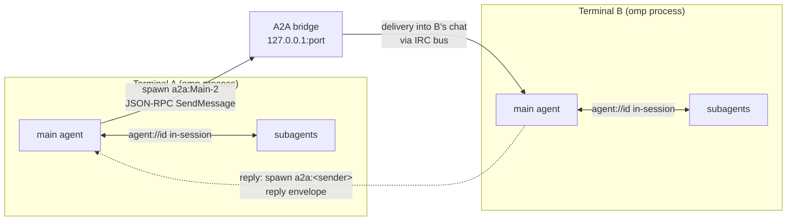

# A2A inter-terminal agent networking

> Every omp process serves an Agent2Agent v1.0 bridge on `127.0.0.1`, so
> sessions running in separate terminals discover each other, address each
> other's agents by name, and exchange tasks and replies over JSON-RPC 2.0.

## What it is

The unit of communication is a *terminal*: one omp process (usually one
interactive session). Two mechanisms cover all agent-to-agent traffic:

- **In-session peer messaging** — subagents inside one omp process message each
  other directly through `agent://<id>` over the IRC bus (rate, dedup, and hop
  limits guard it). See [Agent Hub](./agent-hub.md) for the roster UI.
- **Inter-terminal A2A** — agents in *different processes* reach each other
  through each terminal's A2A bridge: the local loopback server exposing the
  Agent2Agent protocol (agent card at
  `/.well-known/agent-card.json`, JSON-RPC 2.0 over HTTP, optional SSE task
  streaming), plus a client that registers peer bridges and spawns their agents.

The A2A protocol is only served on the loopback interface; a bridge never
accepts connections from other hosts, and every request must present the
bearer token. Terminals sharing one profile share the token file, which is
what makes the zero-config auto-registration below work.

## Quick start

Nothing to enable: `a2a.enabled` is on by default and `a2a.port: 0` picks a
free ephemeral port per terminal. Starting two terminals is enough — each
auto-registers the other's live bridges at session start
(`a2a.autoRegister`), so peer agents are spawnable from the first turn:

1. Terminal A and terminal B each run `omp`.
2. In A, ask the agent to spawn a peer's main agent by its roster name, e.g.
   "spawn `a2a:Main-2` with the prompt: what are you working on?".
3. The task travels to terminal B, lands in its conversation, and the reply
   comes back to A as an incoming message — B's agent follows the reply
   envelope instruction and spawns `a2a:<sender-name>` with its answer.

Manual commands, when auto-registration is off or a peer started later:
`/a2a auto` (re-scan the bridge registry), `/a2a add <url> --token <t>`,
`/a2a list`, `/a2a remove <name>`.

## Addressing and delivery

Each terminal writes its pid/port into `<agent dir>/a2a-bridges.json`; the
registry is pruned by pid liveness, so dead entries disappear on read.
Peer skills become spawnable agents under the `a2a:` prefix. Name collisions
(two terminals whose cards both lead with `Main`) resolve with `-2`/`-3`
suffixes: `a2a:Main` (first), `a2a:Main-2` (second)…

A spawn of `a2a:<name>` goes through the task tool like any agent:

1. The client resolves the bridge URL and sends a JSON-RPC `SendMessage` with
   `metadata` carrying the target skill, the sender's identity, and its bridge
   URL.
2. The server validates the bearer token, resolves the target agent, wraps
   the body in a reply envelope naming `a2a:<sender>`, and delivers it into
   the peer's conversation through the IRC bus (marked `external`, which the
   ingress guard exempts).
3. The caller's spawn settles on the delivery receipt — the addressed delivery
   is fire-and-forget; the reply arrives later as a spawn from the peer.

Task states follow the A2A task model: `SUBMITTED` → `WORKING` →
`COMPLETED`/`FAILED` (a poll loop with backoff, or SSE task updates via
`SendStreamingMessage`). A terminal named with `a2a.name` is addressed by
that identity rather than its registry id.

## Limits and safeguards

| Safeguard | Behavior |
| --- | --- |
| Loopback-only server | The bridge binds `127.0.0.1` and refuses other hosts; bearer token required on every JSON-RPC call. |
| Roster flood guard | `a2a.maxPeerSkills` (default 8) caps skills registered from one peer card — a peer advertising swarms of finished one-shot workers cannot flood the roster. |
| Card filtering | The card lists only the main and currently running agents; finished one-shot workers never appear. |
| Ingress guard | Inbound A2A deliveries are `external` IRC messages, exempt from the rate/dedup/hop guard applied to in-session traffic. |
| Output cap | Published task output is inlined as an artifact capped at 100 k characters; files themselves never travel. |
| Client budget | `a2a.clientTimeoutMs` (default 0, unlimited) bounds a remote spawn; the per-request connect timeout is a fixed 10 s. |

## Settings

All A2A settings live in the tasks tab; see the full table with types and
defaults in [Settings → Inter-terminal agent networking
(A2A)](./settings.md#inter-terminal-agent-networking-a2a). The same section
colocates `session.retentionDays` (session-file GC) and the IRC guard settings.

## Source

- Bridge (server, client, agent bridge, RPC dispatch): `packages/coding-agent/src/a2a/`
- IRC bus and ingress guard: `packages/coding-agent/src/irc/`
- Registry and peer discovery: `packages/coding-agent/src/registry/`
- Tests: `packages/coding-agent/test/a2a-server.test.ts`,
  `packages/coding-agent/test/a2a-client.test.ts`
- Fork notes: `README-fork.md`, `FORK-RU.md`