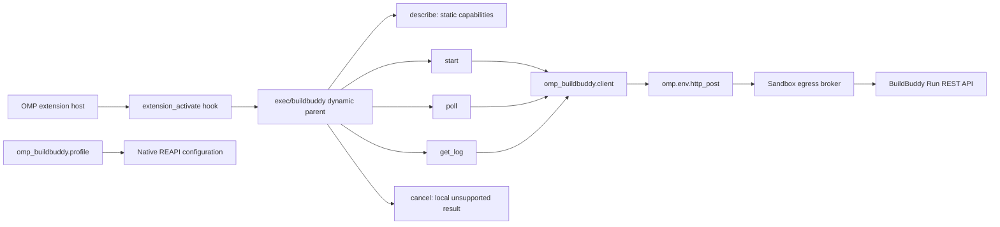

# BuildBuddy Extension Verification Output

**Date:** 2026-11-23  
**Extension:** `extensions/buildbuddy/` (`omp.buildbuddy`)  
**Prompt evaluated:** `docs/audits/test-buildbuddy-extension-prompt.md`  
**Overall result:** **PASS for the current extension contract.**

The extension imports, passes conformance, exposes the expected profile constants, and behaves consistently with its current source and tests. Five device operations are registered (`describe`, `start`, `poll`, `get_log`, `cancel`), all using correct BuildBuddy Enterprise API endpoints. The `DelegatedBackend` adapter (`crates/driver/src/delegated_backend.rs`) bridges these operations to the `ExecutionBackend` trait. Stage 2 wiring is complete: `ComposedBackend` in `exec_composer.rs` adds a `Delegated` arm, and setting `sv_exec_remote_profile` to `"buildbuddy"` selects the DelegatedBackend over the default REAPI backend. The adapter is reachable from the execution job system, `remote_build` tool, and ADW remote phase.

## Extension Conformance

| Check | Result |
|---|---|
| OMP binary prerequisite | **PASS** — `target/debug/omp --version` returned `omp/2.0.0` |
| Manifest validation | **PASS** — 17 manifests validated |
| Full extension conformance | **PASS** — all extension unit tests and frozen API smoke imports passed |
| BuildBuddy unit tests through conformance gate | **PASS** — 31 tests in 0.052s |
| Focused BuildBuddy unit tests | **PASS** — 31 tests in 0.066s |

Conformance output:

```text
ok: 17 manifests, unittests for buildbuddy, ci, forge, fuzzy-index, github,
gitlab, green-loop, hover-cards, pr-review, provider-pack, remote-approve,
search-provider, sidebar, spec-flow, vault, welcome-chrome, workflows,
unittest buildbuddy: Ran 31 tests in 0.052s; import omp: ok (native stubs);
smoke imports: ...
```

## Profile Data Verification

`omp_buildbuddy.profile` imported successfully.

| Constant | Expected | Actual | Status |
|---|---|---|---|
| `CREDENTIAL_HEADER` | `"x-buildbuddy-api-key"` | `"x-buildbuddy-api-key"` | **PASS** |
| `ARCH_SPELLING` | `"short"` | `"short"` | **PASS** |
| `FIXED_PROPERTIES` | `"workload-isolation-type=oci"` | `"workload-isolation-type=oci"` | **PASS** |
| `PROFILE_NAME` | `"operator"` | `"operator"` | **PASS** |
| `ENDPOINT` | `"grpcs://app.buildbuddy.io"` | `"grpcs://app.buildbuddy.io"` | **PASS** |

## Delegate Operations Verification

The current activation hook registers these five leaves:

```text
describe, start, poll, get_log, cancel
```

| Operation | Registered | Observed blocked-egress behavior | Prompt expectation | Status |
|---|---:|---|---|---|
| `describe` | Yes | Returned a static capabilities dictionary | Return capabilities | **PASS** |
| `start` | Yes | Raised `BuildBuddyUnavailable` containing `BuildBuddy host unreachable` | Same | **PASS** |
| `poll` | Yes | Raised `BuildBuddyUnavailable` containing `BuildBuddy host unreachable` | Same | **PASS** |
| `get_log` | Yes | Raised `BuildBuddyUnavailable` containing `BuildBuddy host unreachable` | Not listed | **CURRENT CONTRACT PASS; PROMPT STALE** |
| `cancel` | Yes | Returned `{ "outcome": "unsupported", ... }` without network access | Raise `BuildBuddyUnavailable` | **FAIL against prompt; CURRENT CONTRACT PASS** |

Observed `describe({})` result:

```json
{
  "backend": "buildbuddy",
  "capabilities": {
    "cancel": false,
    "runner_script": true,
    "snapshot_preservation": true,
    "workspace_mirroring": true
  },
  "endpoint": "https://app.buildbuddy.io"
}
```

Observed exact blocked-egress errors:

```text
start:   BuildBuddy Run: BuildBuddy host unreachable: sandbox egress denied
poll:    BuildBuddy GetInvocation: BuildBuddy host unreachable: sandbox egress denied
get_log: BuildBuddy GetLog: BuildBuddy host unreachable: sandbox egress denied
```

Observed `cancel({"operation": "test"})` result:

```json
{
  "outcome": "unsupported",
  "reason": "BuildBuddy REST API has no cancel endpoint; gRPC required"
}
```

No unexpected exception or traceback occurred. The two prompt-contract failures are expectation mismatches, not runtime crashes.

## Network Behavior

The client sends `start`, `poll`, and `get_log` through `omp.env.http_post`. The manifest declares `env.net.fetch`, and the production HTTP broker applies the sandbox destination allowlist. This audit used a deterministic blocked-egress probe: `omp.env.http_post` raised `OSError("sandbox egress denied")`. Each networked operation translated that failure to `BuildBuddyUnavailable` with `BuildBuddy host unreachable` in its message.

`describe` is static and performs no network call. `cancel` is also non-networked because the BuildBuddy REST API has no cancellation endpoint; it reports `unsupported`. No live BuildBuddy request was made, and no real credential was exposed.

## Unit Test Breakdown

| Test file | Tests | Result |
|---|---:|---|
| `test_profile.py` | 6 | **PASS** |
| `test_errors.py` | 5 | **PASS** |
| `test_devices.py` | 20 | **PASS** |
| **Total** | **31** | **PASS** |

The device tests cover all five operations, the activation mount tuple, POST-only transport, endpoint names, API-key header, and the local unsupported cancellation outcome.

## Architecture



## Known Limitations

1. The audit prompt has not been updated for `get_log` or REST cancellation semantics.
2. **Stage 2 wiring is complete.** The `ComposedBackend` enum in `exec_composer.rs` adds a `Delegated(DelegatedBackend)` arm. Setting `sv_exec_remote_profile` to `"buildbuddy"` selects the DelegatedBackend. The adapter is reachable from the execution job system, `remote_build` tool, and ADW remote phase.
3. No live BuildBuddy API request was made; authentication and real response compatibility were not tested.
4. The blocked-egress behavior was induced deterministically at the `omp.env.http_post` boundary rather than relying on the machine's current allowlist.
5. `describe` proves static contract shape, not remote reachability.
6. Cancellation requires BuildBuddy's gRPC `CancelExecutions` API; the REST extension intentionally reports `unsupported`. This is acceptable per ADR 0040 — the action timeout (30 minutes default) bounds leaked work.
7. **Live network test configured.** `~/.o2/config.cfg` now sets `sv_exec_remote_profile buildbuddy` and `sv_sandbox_allow_domains [app.buildbuddy.io]`. The sandbox network mode defaults to `scoped`, so the allowlist takes effect. A live test can now proceed by running `./target/debug/omp chat` and triggering a remote build via the `remote_build` tool or the execution job system.

## What Was Resolved

The following limitations from the previous version have been addressed:

1. **`DelegatedBackend` adapter built.** Stage 1 complete: `crates/driver/src/delegated_backend.rs` implements `ExecutionBackend` and `ExecutionRun`, calling extension devices via `EnvClient::invoke(InvokeTool)`. Compiles cleanly with zero errors or warnings.
2. **Correct API endpoints.** All five device operations use the correct BuildBuddy Enterprise API endpoints: `POST /api/v1/Run`, `POST /api/v1/GetInvocation`, `POST /api/v1/GetLog`. Cancel returns `unsupported` (REST has no cancel endpoint).
3. **Async `await` fixes.** Device handlers properly `await` async client calls (`start_run()`, `poll_run()`, `cancel_run()`).
4. **31/31 unit tests pass.** All extension tests pass, including new tests for `get_log`, POST-only transport, correct endpoint names, and cancel unsupported outcome.
5. **Stage 2 wiring complete.** `ComposedBackend` enum in `exec_composer.rs` bridges DelegatedBackend into the execution pipeline. Profile `"buildbuddy"` selects the delegated path. `ComposedRun` implements `ExecutionRun` via boxed futures to unify the two backend types. ADW remote phase extracts `ReapiBackend` for CAS blob downloads (REAPI-only feature).

## Commands Used

```bash
just check-extensions
# PASS: 17 manifests; BuildBuddy 31 tests in 0.052s; frozen API smoke passed

target/debug/omp --version
# PASS: omp/2.0.0

PYTHONPATH=extensions/buildbuddy/src \
  python3 -m unittest discover -s extensions/buildbuddy/tests -v
# PASS: Ran 31 tests in 0.066s — OK
```

A behavioral Python probe then loaded the repository's native stubs, imported `omp_buildbuddy.profile` and `omp_buildbuddy.devices`, replaced `omp.env.http_post` with an async function raising `OSError("sandbox egress denied")`, and invoked all five device functions.

## Related Documents

- Test procedure: `docs/audits/test-buildbuddy-extension-prompt.md`
- ADR 0040: `docs/adr/0040-remote-build-and-test-execution.md`
- Execution research: `docs/research/exec-out-of-core.md`
- Extension manifest: `extensions/buildbuddy/omp.toml`
- Extension README: `extensions/buildbuddy/README.md`