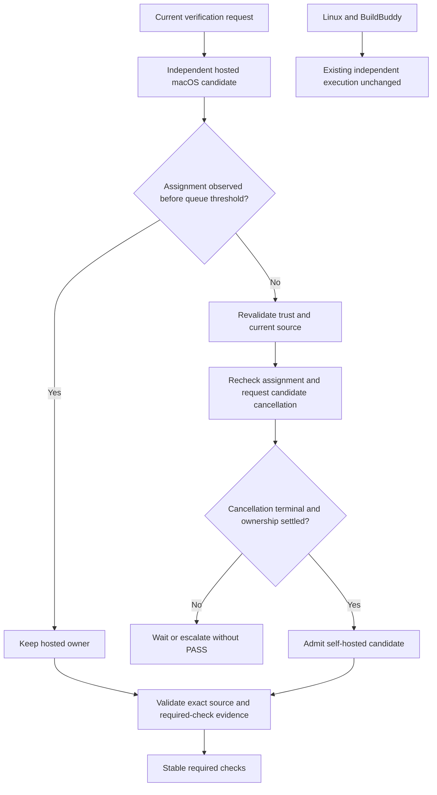

# Hosted-first macOS CI fallback: evaluation and approval plan

Status: plan approved for S0 detailed design and read-only Mac preflight,
2026-11-16. [S0 design](design.md) selects hosted Linux controllers with isolated
macOS workers; [preflight](preflight.md) records live-access blockers. No broader
Mac-writer trust acceptance or activation is implied by plan approval.
No workflow, dispatcher, credential, ruleset or Mac service is changed here.

Implementation follow-up: [code and staged rollout](implementation.md) describe
opt-in hosted-first controllers/workers. Deployment, configuration and live Mac
preflight remain prerequisites; this historical evaluation is not a claim of
active runner diversification.

Inspected OMP2: `1a32fad0dfe602da1db6ee53c24577a7941b8e78` on `omp2`.
This is separate from PR #658's native verifier implementation.
[Source research](sources.md) and [EGM evaluation](egm-review.md) accompany it.

## Goal and scope

Use GitHub-hosted Apple Silicon macOS first. If a candidate waits five minutes
without acquiring a runner, use the owner's Apple Silicon Mac as fallback.
Both pools may serve different requests concurrently. This is queue-capacity
fallback, not retrying failing tests on a different machine.

Only `rust` and `lint_macos` in `.github/workflows/ci.yml` are in scope. Preserve
their commands, affected-check inputs, required-check identities and source
selection. Linux, BuildBuddy, P8, manual packaging, CodeQL and labels retain
their existing execution/routing. External-repository PRs remain hosted-only.
Do not cancel the existing whole CI run or alter `MACOS_RUNNER` globally.

Five minutes is the eligibility threshold, not a five-minute execution SLA.
Polling, cancellation settlement and an offline/busy Mac can extend waiting;
none of these conditions may become PASS.

## Actual native facilities

Links below pin the inspected commit, not a moving branch.

| Existing facility | Source | Consequence |
| --- | --- | --- |
| Inline native macOS jobs, both `runs-on: macos-15` | [rust 420–620](https://github.com/blyzer/oh-my-pi/blob/1a32fad0dfe602da1db6ee53c24577a7941b8e78/.github/workflows/ci.yml#L420-L620), [lint 628–671](https://github.com/blyzer/oh-my-pi/blob/1a32fad0dfe602da1db6ee53c24577a7941b8e78/.github/workflows/ci.yml#L628-L671) | No queue fallback or independent native run boundary exists |
| Hosted-only regression policy | [tests 20–56](https://github.com/blyzer/oh-my-pi/blob/1a32fad0dfe602da1db6ee53c24577a7941b8e78/scripts/test_hosted_runners.py#L20-L56), [AGENTS 95–114](https://github.com/blyzer/oh-my-pi/blob/1a32fad0dfe602da1db6ee53c24577a7941b8e78/AGENTS.md#L95-L114) | Deliberately revise policy and tests; do not silently bypass them |
| Native provisioning and persistent-state composites | [native tools](https://github.com/blyzer/oh-my-pi/blob/1a32fad0dfe602da1db6ee53c24577a7941b8e78/.github/actions/macos-native-tools/action.yml), [build state](https://github.com/blyzer/oh-my-pi/blob/1a32fad0dfe602da1db6ee53c24577a7941b8e78/.github/actions/macos-build-state/action.yml) | Reuse; validate real Mac tool versions and cache ownership |
| Two required native checks | [ruleset 42–43](https://github.com/blyzer/oh-my-pi/blob/1a32fad0dfe602da1db6ee53c24577a7941b8e78/.github/rulesets/omp2-protected.json#L42-L43) | Preserve names/producer semantics, or obtain explicit migration approval |
| Separate BuildBuddy launcher routing | [restoration 49–59](https://github.com/blyzer/oh-my-pi/blob/1a32fad0dfe602da1db6ee53c24577a7941b8e78/docs/research/ci-hosted-runners-restoration.md#L49-L59) | Do not alter its four jobs, variables, caches or secrets |

The workspace job includes full/affected modes, doctests and Seatbelt-dependent
P12. Its `proved-tree` annotation is conditional on complete coverage. Preserve
these distinctions. PR head SHA, the tested synthetic merge commit/tree, push
SHA and merge-group SHA are different identities. Current push reuse also skips
macOS lint based on Rust proof; record that pre-existing behavior without
expanding it or claiming it is freshly verified lint coverage.

Both jobs assume arm64. Provisioning checks `lld`, `uv`, `zstd` and `ninja`, but
the unused `min-version` input proves no LLVM version contract. Rust additionally
needs nextest and the pinned toolchain. Lint's unconditional hosted sccache/cache
setup differs from Rust's self-hosted handling. Resolve this asymmetry in design.
Persistent state is keyed by runner name, not job/run. Never share a developer
checkout or allow parallel services to destructively mutate one cache root.

## Corrections to the initial diagram

1. **Cancellation is run-level.** Documented REST workflow-job endpoints
   inspect/log/rerun; cancel/force-cancel target a workflow run. A called reusable
   workflow is still part of its caller's run. Independent candidate runs are
   needed before automated cancellation can leave Linux/BuildBuddy untouched.
2. **Labels are not alternative queues.** Multiple `runs-on` labels are
   conjunctive. They cannot express hosted first and self-hosted after five minutes.
3. **Assignment and cancellation are not an atomic transaction.** GitHub may
   assign a runner between the last state read and cancellation. The design must
   distinguish observed assignment, admitted execution and accepted evidence.
   Do not promise perfect assignment-time arbitration or exactly-once execution.
4. **Cancellation acceptance is not settlement.** A 202 response is insufficient.
   Confirm terminal candidate cancellation and settled ownership before fallback;
   otherwise wait/escalate without PASS. Never cancel unrelated runs.
5. **Dispatch ref is a branch/tag.** Pin trusted workflow code separately from
   explicit immutable tested-source inputs. An arbitrary SHA input or
   `github.sha` alone does not prove the intended PR merge tree.
6. **Skipped jobs may pass required-check policy.** Separate candidate results
   from the final gate. Missing, skipped, cancelled, stale or failed candidate
   execution cannot justify PASS. Preserve only the original legitimate
   no-Rust-change/already-proven skips.

See [official contracts and inspected actions](sources.md). These are feasibility
constraints, not claims of a functioning dispatcher.

## Alternatives and provisional recommendation

| Option | Fit | Planning recommendation |
| --- | --- | --- |
| Hosted-only reruns | No new machinery; repeated capacity failures remain | Baseline and emergency rollback |
| Mac primary | Simple and warm cache; reverses requested priority | Reject for this request |
| Existing availability/billing chooser | Small dependency; wrong predicate and no queue ownership | Not a drop-in solution |
| Race both full builds and take first success | Duplicate cost and may conceal a real failed test | Reject |
| Independent native candidates plus Mac-side polling controller | Can implement the requested order; adds state/credentials/trust obligations | Preferred direction for detailed design, conditional on proof |
| Hosted Linux controller | Avoids local service; consumes/depends on another hosted runner while waiting | Compare cost/reliability during design |

Reuse existing native composites and commands. If a Mac-side service is selected,
prefer standard-library tooling, persistent local state and OS service supervision
over a new server/framework. Its preference remains conditional: S0 must compare
hosted concurrency occupancy and queue delay against local credential, upgrade
and recovery maintenance. Standard public-repository hosted compute is not
assumed to be billed or exhausted. An action's name is not evidence it handles
this queue.

The final-check producer is a **design-stage decision**. Stable wrapper jobs
in CI retain the GitHub Actions producer but can occupy a Linux runner while
waiting. A scoped GitHub App avoids that occupancy but introduces check
integrity, producer and ruleset migration concerns. Existing push-proof reuse
specifically requires `.app.slug == "github-actions"` and `proved-tree`
annotations (`ci.yml:404–409`); preserve that producer/annotation consumer
contract, or explicitly approve and test its migration. An App reporting the
same check name alone does not preserve push reuse. Never let a skipped old gate
ambiguously coexist with a new check of the same name. This plan is not yet a
zero-decision implementation specification.

This is a feasibility sketch, not a proof of atomic ownership. Separate
candidate runs may be per objective or grouped; S0 must decide grouping and
the rule for a partially assigned group before extraction.

## Mandatory design requirements

- Five minutes of observed queued time is necessary for automatic fallback.
  Test failures, execution timeouts and billing measurements are not triggers.
  Bind timing to the current run attempt/job, not the original run's creation
  time: a rerun must not inherit an earlier five-minute wait. S0 must specify
  timestamp selection and restart/clock handling, with conservative behavior
  when queue timing is unavailable.
- Bind repository, event, PR head/base, tested merge commit/tree, workflow
  revision, objective and attempt. Recheck trust and current identity both
  before fallback and before publication; reject stale publication. The current
  ruleset sets `strict_required_status_checks_policy: false`: if the base changes
  after success, this does not automatically revoke published proof or prevent
  merge. S0 must distinguish this inherited merge policy from any stronger
  requested guarantee. Strong post-publication freshness requires a separately
  approved gate/ruleset mechanism and a base-update-after-success canary; it is
  not implicitly provided by fallback or polling.
- One controller owns decisions. Persist state, reconcile on restart, and
  discover ambiguous dispatch outcomes before retrying. Late/duplicate events
  cannot publish an independently successful gate. No false exactly-once claim.
- Observed running/admitted hosted work keeps ownership. Assignment racing with
  cancellation must settle through terminal cancellation and explicit admission.
  The literal rule “any already-assigned runner always wins” cannot be promised
  from a non-atomic REST read. Obtain owner agreement on observable precedence
  before implementation, rather than silently claiming that stronger guarantee.
- Hosted dispatch, execution **and final required-check publication** must work
  while the Mac/controller is offline. Reject architectures with the Mac as the
  sole publisher of ordinary hosted success. Demonstrate an outage canary.
  Offline/busy fallback remains visible and bounded. Cancel only the controller's
  isolated candidates.
- One heavy Mac slot covers both objectives and other workloads on that Mac.
  Workflow-local concurrency alone does not serialize different workflows or
  multiple runner services. Inventory real registrations and cache paths.
- Same-repository origin is necessary but not a universal trust proof. Define
  allowed writers/branches and review of workflow/source changes. External
  repository PRs are hosted-only. Never execute PR-controlled controller code.
- A writer may bypass the controller by targeting the Mac's labels from another
  workflow. Labels and signed controller decisions are not runner admission
  controls. S0 must verify enforceable runner-access restrictions and test direct
  workflow dispatch bypass. If this account's runner/group controls cannot
  restrict execution to trusted workflows, document the broader writer trust
  boundary and obtain explicit owner acceptance before enabling personal-Mac
  execution. This approval plan is not that risk acceptance.
- Separate controller credentials from the build account/workspace; do not
  provide Actions/check write credentials or inherited BuildBuddy keys to test
  code. A personal Mac executing trusted code is not an OS sandbox. Document
  credential scope, rotation and safe local installation; do not silently create
  or request broad admin/billing PATs.
- Preflight actual arm64, LLVM/linker, toolchain, nextest, disk and Seatbelt.
  Preserve full and affected coverage, doctests and all current acceptance proofs.
- Report queue age, runner/owner, source/workflow identity, dispatch/cancel
  attempts, retries and terminal reasons. Keep failed attempts visible. No
  auto-merge or required-check bypass is part of this work.

## Delivery plan after approval

Complexity is relative, not a calendar estimate. New paths below are candidates,
not existing APIs or implemented files. S0 locks their final boundaries.

| Slice | Files / ownership | Acceptance and tests | Dependencies / complexity |
| --- | --- | --- | --- |
| S0: design and real Mac preflight | Create proposed `docs/research/ci-macos-queue-fallback/design.md`; inspect runner/service/tool/cache inventory | Decide producer/annotation consumer, source/event contract, group ownership, race semantics, access restrictions, post-publication freshness, credential scopes and rollback. Compare controller placements. Verify Mac compatibility without changing CI | Owner approval; medium |
| S1: extract hosted-only native execution | Modify `.github/workflows/ci.yml`; create proposed `.github/workflows/macos-verification.yml`; modify `.github/actions/macos-native-tools/action.yml` and `.github/actions/macos-build-state/action.yml` only if S0 proves necessary; modify `scripts/test_hosted_runners.py`, `scripts/check-ci-paths.py`, `scripts/test_check_ci_paths.py`, `.github/ci-paths.txt`, `.github/ci-rust-paths.txt` as required by extraction | Exact old/new command inventory, full/affected modes, PR merge/push/merge-group identity, skip policy, fork routing, stable checks and actual GitHub Actions producer/`proved-tree` push reuse tested. Hosted stays default. Linux/BuildBuddy bodies unchanged | S0; medium/high |
| S2: controller core against fake APIs | Create proposed `scripts/macos-fallback-controller.py`, `scripts/test_macos_fallback_controller.py` | Fake-clock/API tests: <300s/boundary, observed assignment/race, delayed/failed cancellation, 403/429/5xx, ambiguous dispatch, crashes, duplicates, supersession, changed base, forks, late success and stale publication | S0 protocol; medium/high |
| S3: opt-in lifecycle integration | Modify proposed native workflow/final gate after S1; create proposed `scripts/macos-fallback-launchd.plist` only if local service wins S0 comparison; final gate paths locked in S0 | Hosted success with Mac/controller offline; blocked hosted then one admitted Mac owner; real failures stay failures; busy Mac; restart; direct-dispatch bypass; cleanup; token redaction; exact check/source binding | S1/S2; high |
| S4: canary, rollout and rollback | Modify `AGENTS.md`, `docs/BRANCH_PROTECTION.md`, `docs/research/ci-hosted-runners-restoration.md`, `docs/research/ci-macos-runner-fallback.md`, hosted policy tests; modify `.github/rulesets/omp2-protected.json` only with explicit approval | Trusted PR/push and merge-group canaries as applicable, one-Mac-slot/cache proof, names/producer checks, no Linux/BuildBuddy regression. Disable switch restores hosted-only while draining candidates | Successful S3; medium |

S1 must not remove old required checks before its complete hosted-only reporting
facade is in place. A docs PR is not permission to modify branch protection.
Do not add runtime dependencies or change permissions without S0 justification.
No deletions are proposed. `scripts/test_check_ci_paths.py` has workflow-copy,
inline `proved-tree` mutation and `step_script` helpers; update this existing
test infrastructure alongside extraction instead of assuming new paths are
automatically tested. S0 must lock a final per-slice Create/Modify/Delete allowlist
before implementation, particularly for the selected final-check mechanism.
The repository default branch is currently `omp2` (read-only API inspection,
2026-11-16). Include default-branch workflow discovery/bootstrap in S0: do not
assume an unmerged dispatch workflow can be exercised like a deployed workflow.
Stage inert/hosted-only workflow availability before live fallback canaries.

## Evaluation and remaining uncertainties

Retain raw fixtures and expected state transitions. Standard-library fake API
tests and YAML/policy validation do not prove real runner ownership, macOS
execution or cancellation cleanup. Both a real hosted and a real Mac canary
are required. The currently available connection has returned403 for runner
and variable inventory; Mac availability, registrations and credential access
remain unverified.

Measure queue-to-start separately from queue-to-final-result, duplicate dispatch
and overlap, Mac busy time, API request/rate-limit use, cancellation settlement,
stale-result rejection, required-check completion and unchanged test outcomes.
Keep source/tool versions equal in comparisons. No latency improvement or
five-minute SLA has been measured in this investigation.

## Approval boundary

The owner approved proceeding to S0 detailed design and read-only preflight.
That approval does not install Mac services, create tokens, accept broader Mac
writer trust, modify rulesets or enable live fallback. The design/preflight
records distinguish completed source work from blocked operational checks.
Unresolved EGM findings remain in [egm-review.md](egm-review.md).
