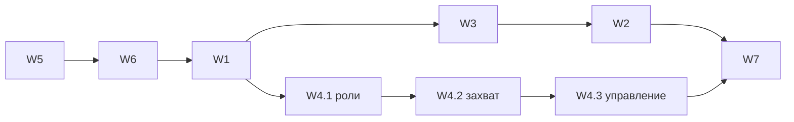

# Исправления по итогам живой проверки: дизайн

Дата: 2026-11-08. База: `origin/main` `b0f6a53206`.
Источник: живые прогоны в профиле `agents` и разбор кода по транскриптам
(A2A, Agent Teams, `handback`, предсуществующие падения тестов).
Решения по спорным вопросам приняты владельцем продукта 2026-11-08 и
зафиксированы ниже как контракт.

Пути `src/` и `test/` даны относительно `packages/coding-agent/`.

## 0. Объём

| # | Направление | Тип |
|---|---|---|
| W1 | `handback`: согласовать завершение и извлечение отчёта; `task.structured` по умолчанию `true` | дефект + смена умолчания |
| W2 | A2A: ответ на запрос как ожидаемая async-задача отправителя; автопересылка ответа для адресованного субагента | дефект дизайна |
| W3 | A2A: ожидающий спавн не помечается `FAILED`, пока регистрация не завершилась | дефект состояния |
| W4 | Teams: командный режим ролей, атомарный захват задач, протокол управления (простой, остановка, план) | дефект + расширение |
| W5 | Встроенный shell: `>/dev/null` на Windows | дефект upstream, чиним в форке + PR |
| W6 | Изоляция тестов `skill-list`, `integrations` | дефект тестов |
| W7 | Документация: README, `docs/a2a.md`, `docs/agent-teams.md`, CHANGELOG | следствие |

Не входит: межтерминальные команды (Teams остаются в пределах одного
процесса), передача ответственности за A2A-запрос от Main дочернему
агенту, A2A между машинами, режим `a2aSpawn: true` (у него уже есть
task-backed путь через `GetTask`).

## W1. `handback` и `task.structured`

### Причина

Записанный «сбой» `SrcSurvey` вызван одноимённым Python-инструментом,
переданным через `task.tools`: он перекрыл встроенный `handback`
(`src/sdk.ts:3864`, `toolRegistry.set`). Executor выбирает обработчик
завершения по имени (`src/task/executor.ts:2066`). Чужой результат не
проходит `extractYieldToolData` (`src/tools/yield.ts:802`), но
`yieldToolShouldTerminate` (`src/tools/yield.ts:820`) его принимает. Итог:
прерывание без принятого отчёта, `exit 1`, `(no output)`.

### Решение

1. **Завершение только после принятого отчёта.** Executor вызывает
   `requestAbort("terminate")` для `yield`/`handback`, только если для этого
   же результата извлечение вернуло данные. Терминатор не может
   сработать на результате, который отклонил экстрактор.
2. **Зарезервированные имена.** `yield` и `handback` нельзя перекрыть
   пользовательскими инструментами (`task.tools`, eval-инструменты,
   расширения в дочерней сессии). Попытка даёт ошибку валидации задачи
   до спавна: `tool name "handback" is reserved`.
3. **`task.structured` по умолчанию `true`** (`src/task/settings.ts`).
   Workflow сохраняет явное `structured: false`. Явное `false` в
   конфигурации по-прежнему отключает режим.

### Риски

- Смена умолчания меняет поведение каждого субагента: появляется
  `handback`, системный промпт требует завершения через него. Если
  ребёнок без схемы закончил работу, не вызвав `handback`, результатом
  становится текст **последнего** хода ассистента (`lastReportTurnText`),
  с `exit 0`. Сейчас `monitor.rawOutput()` склеивает текст всех ходов,
  включая ответы на напоминания; это исправляется вместе с W1.
- Тесты, которые фиксируют умолчание `false`, переписываются под новый
  контракт, а не удаляются молча.

## W2. A2A: ожидание ответа и автопересылка

### Причина

Отправитель не ведёт учёт своих запросов. `A2aClient.sendAndWait()`
завершается на квитанции доставки, а `#runA2aSpawn()` (`src/task/index.ts:2173`)
упаковывает её в завершённый `<task-result>`. Ответ с `inReplyTo` приходит
обычным IRC-сообщением, и `wait` ждать нечего. Автопересылка ответа
(`src/a2a/reply-relay.ts`) подписана только на Main.

### Контракт отправителя

- **Регистрация до отправки.** `#runA2aSpawn()` в режиме адресной доставки
  создаёт запись исходящего запроса `{messageId, peer, ownerId, jobId,
  deadline}` и async-задачу (`AsyncJobManager.register("task", …)`,
  `ownerId` = вызывающий агент), затем отправляет сообщение с этим
  `messageId`. `A2aClient.sendMessage()` принимает `messageId` от
  вызывающего.
- **Результат вызова `task`** — «доставлено, ответ ожидается в задаче
  `<jobId>`», статус задачи `running`. Не `completed`.
- **Закрытие задачи.** Входящее сообщение с `inReplyTo`, совпадающим по
  `messageId` и по отправителю (`from` = ожидаемый peer), завершает задачу
  текстом ответа. Такой ответ доставляется один раз — через задачу; копия
  в IRC не создаётся. Несовпавший или поздний ответ идёт в IRC, как сейчас.
- **Ошибки.** Отказ доставки — задача `failed` сразу. Истёк срок —
  `failed` с причиной `reply timeout`. Отмена задачи снимает только
  ожидание; у получателя ничего не отменяется.
- **Срок.** Новая настройка `a2a.replyTimeoutMs`, по умолчанию
  `1_800_000` (30 мин), `0` — без срока. `a2a.clientTimeoutMs` остаётся
  сроком транспорта.
- **Ответ на чужой запрос** (вызов несёт `inReplyTo`) задачу ожидания не
  создаёт: это доставка без ответа.
- **Без менеджера задач** (нет async-поддержки в сессии) вызов ждёт ответ
  внутри себя с тем же сроком.
- **Где живёт учёт.** Реестр исходящих запросов — один на процесс,
  рядом с A2A-сервером (`src/a2a/`), а не в `A2aAgentBridge` отдельной
  сессии: ответ приходит на сервер процесса, а запрос мог отправить
  субагент в worker-потоке. Worker обращается к реестру через
  main-owned thread-сервис по существующему образцу `src/thread/services/`.
- **Парковка.** Агент с незакрытой задачей ожидания A2A не паркуется
  (`unsavedAgentWork` в `src/registry/agent-lifecycle.ts` учитывает такие задачи).

`wait` менять не нужно: задача владельца делает его ожидание
содержательным. Окна простоя `wait` остаются прежними; завершение задачи
будит сессию штатно.

### Контракт получателя

- Входящий запрос уже записывается с `to` (адресат). Ответственный за
  ответ — адресат: Main или субагент.
- **Main**: текущий `reply-relay.ts` без изменений по сути.
- **Субагент**: после завершения хода, разбуженного внешним запросом
  (монитор wake-хода в `src/task/executor.ts`, после `finalizeRunResult()`),
  итоговый текст уходит отправителю через `spawnA2aAgent` с `inReplyTo`,
  если запрос ещё не закрыт явным ответом. Локальная IRC-пересылка
  `relayWakeTurnOutput()` для внешних запросов не применяется
  (псевдо-отправитель `a2a` недостижим).
- Каждый запрос закрывается не больше одного раза. Явный ответ через
  `task` и автопересылка расходуют одну и ту же запись.
- `irc-bridge.ts` сохраняет `a2aInReplyTo` в `details` записи.
- `prompts/system/irc-incoming.md`: для внешнего запроса одна формулировка
  для Main и субагента — «ответ отправляется через `task` агенту
  `a2a:<sender>`; если закончишь ход без этого, итоговый текст будет
  отправлен автоматически».

## W3. A2A: ожидающий спавн

### Причина

`SpawnPendingError` несёт живой промис `registration`, но
`src/a2a/rpc.ts:549` его отбрасывает, а `src/a2a/server.ts:175` через 30 с
отсутствия в реестре отдаёт `TASK_STATE_FAILED` (final) и закрывает поток.
Запуск при этом продолжается.

### Решение

- RPC сохраняет `registration` в записи задачи моста.
- Успешная регистрация переводит задачу в фактическое состояние агента;
  отказ регистрации — в `FAILED` с причиной.
- Вывод `FAILED` по таймеру отсутствия в реестре удаляется. Задача
  остаётся `SUBMITTED`, пока регистрация не завершилась.
- `GetTask`, `ListTasks` и SSE-поток показывают одно и то же состояние.
- `CancelTask` для ожидающей задачи записывает намерение и применяет его
  после регистрации.

## W4. Agent Teams

### W4.1 Командный режим ролей

Причина: `/team start` добавляет участнику полный `write`
(`withTeamIrcTools`, `src/task/structured-subagent.ts:488`), но системный
промпт scout/reviewer по-прежнему требует «NEVER write». Права записи на
диск при этом шире, чем нужно для координации.

Решение:

- `AgentDefinition` получает необязательный `teamSystemPrompt`. В
  markdown-определении он задаётся полем frontmatter `team-prompt:
  <путь к файлу рядом с определением>`. Bundled `scout` и `reviewer`
  получают командные варианты: запрет на изменение репозитория
  сохраняется, явно разрешены сообщения `agent://`, операции `team://`
  и итоговый отчёт ведущему.
- При запуске в команде используется `teamSystemPrompt`, если он есть,
  иначе основной промпт.
- Вместо полного `write` участник получает **координационную запись**:
  отдельная возможность `coordinationOnlyWrite`, которая пропускает
  только схемы `agent://` и `team://` после нормализации цели, независимо
  от включения xdev. `deviceOnlyWrite` для этого не подходит: он
  разрешает также устройства `xd://`, `local://` и другие операции без
  файла. Определения, где `write` уже есть, сохраняют его.
- Проверка совместимости перед стартом команды: определение без
  инструментов записи на диск (`isReadOnlyAgent`) или с `team: false` во
  frontmatter и без `teamSystemPrompt` — отказ `/team start` с указанием
  участника и причины. Проверка по свойствам определения, не по имени.
- Общий шаблон субагента для участника команды: вместо «итог уходит
  Main автоматически, без промежуточных сообщений» — правила команды
  (координация с участниками напрямую, отчёт ведущему).

### W4.2 Атомарный захват задач

Причина: владение в `TASKS.md` — договорённость о правке файла;
«прочитать → проверить → записать» не атомарно. В исходном дизайне это
отложено сознательно (§3, §8, §10.4).

Решение:

- Новый main-owned `TeamRuntime` (`src/task/team-runtime.ts`): состояние
  запущенных команд, перенесённое из `builtin-teams.ts` (участники,
  поколения, ведущий), и реестр задач.
- Реестр задач команды хранится в `<workspace>/tasks.json` (источник
  истины). `TASKS.md` — генерируемое представление; участники его не
  правят. Без `workspace` реестр живёт в памяти рантайма. Если в
  workspace уже есть `TASKS.md` без `tasks.json`, старт команды
  отказывает с инструкцией по переносу и не перезаписывает файл;
  повреждённый `tasks.json` — тоже отказ.
- Протокол `team://` (`src/internal-urls/team-protocol.ts`, регистрация в
  существующем роутере):
  - `read team://<team>/tasks` — список `{id, title, owner, status, note}`;
  - `write team://<team>/tasks` (только ведущий) — добавить задачу, тело —
    заголовок;
  - `write team://<team>/tasks/<id>/claim` — захват;
  - `write team://<team>/tasks/<id>/release` — освобождение (владелец или ведущий);
  - `write team://<team>/tasks/<id>/done` — завершение, тело — заметка.
- Захват: заявитель определяется по вызывающей сессии, не по
  аргументу. Проверка членства и поколения. Последовательность «чтение →
  проверка владельца → запись на диск» выполняется под мьютексом,
  ключ — канонический путь `tasks.json` (две команды с одним workspace
  делят замок). Ответы: успех; идемпотентный успех для того же владельца;
  конфликт с именем текущего владельца.
- Worker-потоки обращаются к рантайму через main-owned thread-сервис.
- Граница: защита работает в пределах процесса omp. Прямую правку
  `tasks.json` сторонним процессом она не предотвращает; это указывается
  в документации.
- `/team start <name> [assignment]` может принять начальный список задач
  из раздела `tasks:` файла команды (необязательный).

### W4.3 Протокол управления

- **Уведомление о простое.** Рантайм подписан на события реестра;
  переход участника `running → idle` даёт ведущему (фактический ref
  ведущего, не константа `Main`) одно уведомление-не-запрос: участник,
  итог хода (первые строки) и ссылка `agent://<handle>`. Дедупликация
  по поколению и переходу; уведомление не порождает автоответов и
  wake-relay.
- **Кооперативная остановка.** `/team stop <name|handle>` отправляет
  участнику управляющее сообщение с `requestId`. Участник отвечает
  `write team://<team>/stop/<requestId>` с телом `ack` или
  `decline: <причина>`. На `ack` рантайм выполняет существующий
  `lifecycle.release(…, { tombstone: true })`. Отказ и отсутствие ответа
  за `team.stopAckTimeoutMs` (по умолчанию 120 000) сообщаются ведущему;
  принудительной остановки по таймеру нет. `/team stop --force` —
  текущее немедленное поведение. Намерение остановить ожидающего
  регистрации участника сохраняется и применяется после регистрации.
- **Согласование плана.** Поле `planApproval: true` у участника (или у
  команды целиком). Такой участник стартует с командным шлюзом в
  `AgentSession.#beforeToolCall`: разрешены чтение и поиск (`read`,
  `grep`, `glob`, `lsp`, `web_search`), `wait` и координационная запись;
  остальные вызовы отклоняются с текстом «нужно одобрение плана:
  отправь его через `write team://<team>/plan`». План уходит ведущему
  уведомлением. `/team approve <handle>` снимает шлюз;
  `/team reject <handle> <причина>` возвращает причину участнику, шлюз
  остаётся. Режим plan mode сессии не используется: он отключает
  автономные IRC-пробуждения, а участник должен на них реагировать.

### Настройки

`team.stopAckTimeoutMs` (число, 120 000). Остальные — без изменений.

## W5. Shell: `/dev/null` на Windows

Причина: `host_path` (`crates/pi-shell/src/sys/fs.rs:429`) передаёт
`/dev/null` как обычный путь; на Windows открытие падает («The system
cannot find the path specified»). Ломается любая команда агента с
`>/dev/null` или `2>/dev/null`. Код upstream, в upstream `main` не исправлен.

Решение: на Windows `host_path` отображает ровно `/dev/null` в `NUL`.
Это покрывает `open`, `stat` и `test -e`. Rust-тест на отображение;
`test/job-widgets/pipe-source.test.ts` проходит на Windows. После слияния
в форк — PR в `can1357/oh-my-pi`.

## W6. Изоляция тестов

- `test/cli/skill-list.test.ts` находит навыки из окружения
  разработчика: `CLAUDE_CONFIG_DIR` переопределяет домашний каталог
  провайдера Claude, а `~/.agents/skills` приходит через `ctx.home`
  (какой путь обходит подмену `os.homedir`, устанавливается
  воспроизведением). Тест изолирует и восстанавливает `CLAUDE_CONFIG_DIR`,
  `PI_CONFIG_FILES`, `HOME`, `USERPROFILE` и переменные профиля;
  обнаружение навыков в продукте не меняется.
- `test/thread/integrations.test.ts` падает только после `skill-list`.
  Это дефект кода, а не только теста: `runSkillsCommand`
  (`src/cli/skill-list.ts`) отбрасывает функцию освобождения от
  `initializeWithSettings`, и `src/capability/index.ts` удерживает эти
  Settings. Thread-сервис настроек отправляет worker'у привязанные
  Settings, их `attach` тянет `AgentStorage`, а в тестовом worker'е нет
  `runtimeThreadService` с кодеком хранилища. Исправление:
  `runSkillsCommand` освобождает своё удержание в `finally`; тестовый
  worker регистрирует `runtimeThreadService` с обеих сторон, как в
  продукте; `startServiceWorker` при сбое загрузки закрывает связь и
  завершает worker.
- Критерий: оба файла и их совместный запуск зелёные на Windows.

## W7. Документация

- README/README-RU: строка `handback` — убрать неверное «failed (exit 1)
  после успешного handback», описать реальную причину и исправление.
- `docs/a2a.md`: задача ожидания ответа, `a2a.replyTimeoutMs`,
  автопересылка для субагентов, состояние ожидающего спавна.
- `docs/agent-teams.md`: командный режим ролей, `team://`, протокол
  управления, настройки. В `docs/specs/2026-11-06-agent-teams-design.md`
  — поправка: §9 остаётся в силе; атомарный захват и протокол управления
  — расширения; противоречивая сборка промпта и вывод `FAILED` по таймеру
  — исправления; утверждение, что wake-relay даёт уведомление о простое,
  неверно.
- `CHANGELOG.md` (`[Unreleased]`) для `coding-agent` и `pi-shell`.

## Порядок и зависимости

W5 и W6 первыми: без них полный прогон тестов на Windows красный. W1
меняет умолчание субагентов, от которого зависят тесты W2 и W4. W3
раньше W2: оба меняют `rpc.ts`/`server.ts`.

## Проверка

- Для каждого дефекта — регресс-тест, падающий до правки.
- Живые прогоны в профиле `agents`:
  - A2A: отправитель ждёт ответ через `wait` без `sleep`-циклов;
    субагент получателя отвечает автоматически;
  - Teams: scout/reviewer в команде координируются и захватывают
    задачи; двойной захват даёт конфликт; уведомления о простое
    приходят ведущему; кооперативная остановка; шлюз плана.
- Полный набор тестов `coding-agent` и `cargo test -p pi-shell` зелёные на
  Windows.
