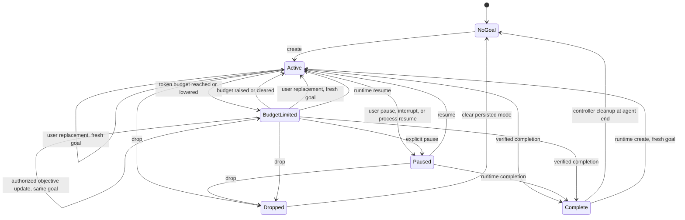

# Developing `@oh-my-pi/pi-coding-agent`

This package is the `omp` CLI. This file is a **developer's map**: where things live
in `src/`, how to run the local loops, and — for each subsystem — which document in
the repo [`docs/`](../../docs/) tree is the authoritative reference.

The long architecture walkthrough that used to live here drifted out of date faster
than anyone re-read it. The `docs/` tree is kept current (and indexed for the
in-agent `docs://` / `/docs` surface), so this file links there instead of
duplicating prose that goes stale.

## Local development

Run from `packages/coding-agent/` (or add `--cwd=packages/coding-agent`):

| Task                           | Command               |
| ------------------------------ | --------------------- |
| Typecheck + lint (the gate)    | `bun run check`       |
| Types only                     | `bun run check:types` |
| Lint only                      | `bun run lint`        |
| Tests                          | `bun run test`        |
| Autofix: lint + format prompts | `bun run fix`         |
| Build the `dist/omp` binary    | `bun run build`       |

Never invoke `tsc`/`npx tsc` directly — `bun run check` is the typecheck gate. After
changing export HTML/CSS/JS, web themes, or the shared tool/trace renderers, run
`bun run gen:export-viewer` and include `src/export/html/viewer.generated.json`
with the change. The generated JS lives in ignored `export-assets/`; CI verifies
the committed metadata (`--check`, also implied by `CI=true`) and publishes the
exact asset from the Linux binary build alongside the release binaries.

Exports from a source checkout inline the generated viewer, so `bun gen:export-viewer`
followed by `/export` exercises local changes without publishing or a local
server. Packaged releases reference their versioned `build.stencil.so` viewer.
Both load Markdown and Highlight.js from immutable content-addressed
`stencil.so/assets/omp/` files. Keep those files on the site permanently: older
exports reference them directly.

Scope fake timers to the deadline a test exercises, then restore real timers
before real socket listeners are started. Bun's mocked clock can defer
`server.listen` callbacks, leaving registry publication and teardown waiting.

Tests that call `setAgentDir()` must snapshot and restore `PI_CODING_AGENT_DIR`,
`OMP_PROFILE`, and `PI_PROFILE` for each test, then call
`__resetDirsFromEnvForTests()` after restoration. Home-directory discovery fixtures
must clear and restore `PI_CODING_AGENT_DIR` so inherited overrides cannot bypass
the fixture. Reuse `restoreEnvValue()` from `test/helpers/settings-test-state.ts`
to preserve unset values.

## Boot flow

```text
process argv
   │
   ▼
src/cli.ts (runCli)            ── worker-host dispatch + Bun version guard;
   │  default subcommand: launch    argv normalization
   ▼
src/commands/* (+ src/cli/)   ── per-command adapters
   │
   ▼
src/main.ts (runRootCommand)  ── theme / settings / model registry / session opts
   │
   ▼
createAgentSession(...)        ── src/sdk.ts → AgentSession
   │
   ├── InteractiveMode   (src/modes/, TUI event loop)
   ├── runPrintMode      (one-shot text/json)
   └── runRpcMode        (JSONL stdin/stdout server)
```

`cli.ts` doubles as the worker host: it declares itself via `declareWorkerHostEntry()`
and dispatches the hidden `__omp_worker_*` argv selectors before loading the command
registry (see `AGENTS.md` → _Worker scripts_).

## Source layout (`src/`)

Top-level entry modules: `cli.ts`, `main.ts`, `sdk.ts`, `index.ts` (SDK barrel),
`config.ts`, `system-prompt.ts`, `thinking.ts`, `workspace-tree.ts`,
`cli-commands.ts`, `telemetry-export.ts`.

| Directory                                                | Responsibility                                               | Reference                                                                                                                                                    |
| -------------------------------------------------------- | ------------------------------------------------------------ | ------------------------------------------------------------------------------------------------------------------------------------------------------------ |
| `cli/`, `commands/`, `commit/`, `export/`                | Command-line adapters and concrete subcommands               | —                                                                                                                                                            |
| `modes/`                                                 | Interactive TUI, print, and RPC runtimes                     | [rpc.md](../../docs/rpc.md), [sdk.md](../../docs/sdk.md)                                                                                                     |
| `session/`                                               | `AgentSession`, JSONL session tree, storage, history         | [session.md](../../docs/session.md), [session-tree-plan.md](../../docs/session-tree-plan.md)                                                                 |
| `config/`, `registry/`, `secrets/`                       | Settings, model/provider registry, secret obfuscation        | [settings.md](../../docs/settings.md), [config-usage.md](../../docs/config-usage.md), [models.md](../../docs/models.md), [secrets.md](../../docs/secrets.md) |
| `tools/`                                                 | Built-in tool implementations + render/meta helpers          | [custom-tools.md](../../docs/custom-tools.md), [`tools/`](../../docs/tools/)                                                                                 |
| `exec/`, `eval/`, `ssh/`, `dap/`, `debug/`               | Execution backends (shell, py/js kernels, ssh, debugger)     | [bash-tool-runtime.md](../../docs/bash-tool-runtime.md), [python-repl.md](../../docs/python-repl.md)                                                         |
| `lsp/`                                                   | Language-server client/runtime                               | [lsp-config.md](../../docs/lsp-config.md), [tools/lsp.md](../../docs/tools/lsp.md)                                                                           |
| `task/`, `swarm/`, `irc/`, `goals/`, `plan-mode/`        | Subagent delegation, parallelism, inter-agent IRC, plan mode | [task-agent-discovery.md](../../docs/task-agent-discovery.md), [tools/task.md](../../docs/tools/task.md)                                                     |
| `web/`, `exa/`                                           | Fetch, browser automation, search providers, scrapers        | [tools/web_search.md](../../docs/tools/web_search.md), [tools/browser.md](../../docs/tools/browser.md)                                                       |
| `mcp/`                                                   | MCP transport / manager / loader / tool bridge               | [mcp-config.md](../../docs/mcp-config.md), [mcp-runtime-lifecycle.md](../../docs/mcp-runtime-lifecycle.md)                                                   |
| `extensibility/`, `slash-commands/`                      | Extensions, hooks, custom tools/commands, skills, plugins    | [extensions.md](../../docs/extensions.md), [hooks.md](../../docs/hooks.md), [skills.md](../../docs/skills.md)                                                |
| `capability/`, `discovery/`                              | Capability registry + provider discovery modules             | [extension-loading.md](../../docs/extension-loading.md), [context-files.md](../../docs/context-files.md)                                                     |
| `advisor/`, `autolearn/`, `autoresearch/`                | Advisor/watchdog, managed skills, background research        | [advisor-watchdog.md](../../docs/advisor-watchdog.md)                                                                                                        |
| `memories/`, `memory-backend/`, `mnemopi/`, `hindsight/` | Memory subsystems and backends                               | [memory.md](../../docs/memory.md), [mnemosyne-memory-backend.md](../../docs/mnemosyne-memory-backend.md)                                                     |
| `internal-urls/`                                         | Router + handlers (`agent://`, `docs://`, `rule://`, …)      | [tree.md](../../docs/tree.md)                                                                                                                                |
| `tui/`, `collab/`                                        | Low-level TUI primitives, live session sharing               | [tui.md](../../docs/tui.md), [collab.md](../../docs/collab.md)                                                                                               |
| `tts/`, `stt/`                                           | Text-to-speech / speech-to-text                              | —                                                                                                                                                            |
| `tiny/`, `auto-thinking/`                                | Embedded tiny-model experiments, auto thinking level         | [local-models.md](../../docs/local-models.md)                                                                                                                |
| `async/`, `lib/`, `utils/`, `prompts/`, `edit/`          | Shared plumbing, prompt assets, patch/diff engine            | [tools/edit.md](../../docs/tools/edit.md)                                                                                                                    |

## Subsystem reference

### Sessions, persistence, and turn lifecycle

- [session.md](../../docs/session.md) — storage and entry model
- [session-tree-plan.md](../../docs/session-tree-plan.md) — branch/tree architecture
- [session-switching-and-recent-listing.md](../../docs/session-switching-and-recent-listing.md)
- [session-operations-export-share-fork-resume.md](../../docs/session-operations-export-share-fork-resume.md)
- [compaction.md](../../docs/compaction.md) — compaction and branch summaries
- [ttsr-injection-lifecycle.md](../../docs/ttsr-injection-lifecycle.md)
- [non-compaction-retry-policy.md](../../docs/non-compaction-retry-policy.md)
- [handoff-generation-pipeline.md](../../docs/handoff-generation-pipeline.md)

#### Goals and model objective edits

[`GoalRuntime`](src/goals/runtime.ts) owns serialized goal mutations and accounting.
[`AgentSession`](src/session/agent-session.ts) supplies live state, usage totals, hidden
messages, `goal_updated` events, and persisted `mode_change` snapshots.
[`InteractiveMode`](src/modes/interactive-mode.ts) and the
[`RPC goal controller`](src/modes/rpc/rpc-goal.ts) own continuation admission and tool-set restoration.



The diagram combines runtime transitions with controller cleanup; an edge does not imply
that every caller exposes the corresponding operation. `GoalModeState` also carries
`enabled` and `mode`. Active and budget-limited goals are enabled; paused goals are
disabled. Completion temporarily sets `mode: "exiting"` with `enabled: false` in memory.
Dropped is an event snapshot, followed by clearing the goal record. See
[`GoalModeState` and `goalFromModeData`](src/goals/state.ts) and
[`Goal`/`GoalStatus`](../tui/src/tools/goal.ts).

Controller resume actions require a paused goal. The lower-level `resumeGoal` method
rejects missing or complete goals but otherwise sets status to active; it does not change
the budget or accumulated usage. These existing lifecycle permissions are unchanged by
objective editing.

- **Creation and exposure:** `createGoal` rejects unfinished goals and initializes identity,
  timestamps, and zero usage. The SDK registers the hidden tool eagerly or lazily, but normal
  chats do not expose it. Goal entry adds it; pause/drop/completion restore the prior tool set.
  `/guided-goal` exposes it before a record exists so the interview can end with `create`.
  Restricted tool sessions cannot expose it. See [`tools/index.ts`](src/tools/index.ts),
  [`sdk.ts`](src/sdk.ts), and `InteractiveMode.handleGuidedGoalCommand`.
- **Accounting and limits:** turn start captures a usage baseline and goal ID. Charged tokens
  are positive deltas of input + cache writes + output; cache reads are excluded. Elapsed time
  is counted in whole seconds. Both active and budget-limited goals accrue usage. Crossing a
  budget changes status and may steer the model, but does not abort work or mark completion.
  User budget changes can reactivate a budget-limited goal. Ordinary wall-clock-only ticks
  stay in memory; token deltas, limit transitions, and internal-abort accounting persist.
  There is no separate elapsed-time limit. See `GoalRuntime.onTurnStart`, `flushUsage`,
  `onBudgetMutated`, and `onTaskAborted`.
- **Continuation:** interactive admission uses an 800 ms idle delay; RPC continuation requires
  opting into `"rpc"` in `goal.continuationModes`. Both require an enabled active goal and
  reject busy/input/session-transition conflicts. Interactive admission also checks editor
  text/images and plan/loop modes. Blocked-only todos suppress continuation without a
  separate blocked goal status. Empty or repeated tool activity suppresses further automatic
  turns until new user activity resets suppression. Continuation prompts read the live
  objective at admission. See `InteractiveMode.#scheduleGoalContinuation`,
  [`RpcGoalController`](src/modes/rpc/rpc-goal.ts), and
  [`goalContinuationActivity`](src/goals/state.ts).
- **Restore, fork, and compaction:** mode snapshots contain the entire goal. Reconstruction
  follows the selected journal branch independently of compacted model messages.
  Process resume pauses an active goal; internal reconciliation can preserve it and reset
  its wall-clock anchor. Forks retain the source branch's goal identity and accounting.
  Subsequent model prompts rebuild goal context from live state. See
  [`session-context.ts`](src/session/session-context.ts), `GoalRuntime.onThreadResumed`,
  and [`SessionManager`](src/session/session-manager.ts).
- **Replacement versus editing:** user `/goal set` calls `replaceGoal`, which creates a fresh
  goal and resets accounting. Model `goal({op:"update", objective:"..."})` instead calls
  `updateGoalObjective`, changing only objective and `updatedAt`. It preserves identity,
  status, budget, and accumulated usage, persists the snapshot, and emits the standard event.
  Its tool result carries the new objective without interrupting other work in the tool batch.

`goal.modelObjectiveUpdates` is persisted through the settings registry and appears under
**Tasks → Modes → Goal Objective Updates**. Changes apply to the existing tool immediately.

| Value | Model behavior |
| --- | --- |
| `disabled` (default) | Reject objective edits; ask the user to use `/goal set`. |
| `confirm` | Require approval of each old/new objective through the host's scrollable approval UI. Denial, cancellation, or a missing approval surface leaves the goal unchanged. Global auto-approval does not bypass this check. |
| `on-request` | Permit an edit without another prompt when the model interprets an explicit natural-language user request. This trusts the model; it does not independently verify intent. |

All modes leave budget editing user-controlled through `/goal budget`. The tool rejects a
`token_budget` argument on `update`, and cannot edit an inactive goal. Consent is checked
against the same session, goal identity, old objective, and live permissions at mutation time;
stale consent is rejected. Automatic continuation is not user authorization. These editing
permissions do not override ordinary tool-approval requirements or deny policies.
See [`settings.ts`](src/goals/settings.ts), [`GoalTool`](src/goals/tools/goal-tool.ts),
and the static [`goal tool instructions`](src/prompts/tools/goal.md).

### Configuration, models, providers, auth

- [settings.md](../../docs/settings.md), [config-usage.md](../../docs/config-usage.md)
- [environment-variables.md](../../docs/environment-variables.md)
- [models.md](../../docs/models.md), [providers.md](../../docs/providers.md), [adding-a-provider.md](../../docs/adding-a-provider.md)
- [local-models.md](../../docs/local-models.md)
- [provider-streaming-internals.md](../../docs/provider-streaming-internals.md), [ai-schema-normalize.md](../../docs/ai-schema-normalize.md)
- [toolconv/](../../docs/toolconv/) — per-family tool-call conversion (anthropic, deepseek, gemini, gemma, glm-4.5, harmony, hermes, kimi-k2, minimax, pi-native, qwen3, xml); see also [ERRATA-GPT5-HARMONY.md](../../docs/ERRATA-GPT5-HARMONY.md)
- [keybindings.md](../../docs/keybindings.md)
- [secrets.md](../../docs/secrets.md), [auth-broker-gateway.md](../../docs/auth-broker-gateway.md), [install-id.md](../../docs/install-id.md)
- [system-prompt-customization.md](../../docs/system-prompt-customization.md)

### Tools framework and built-in tools

- Authoring + registry: [custom-tools.md](../../docs/custom-tools.md)
- Output/artifacts: [blob-artifact-architecture.md](../../docs/blob-artifact-architecture.md)
- Gating/approval: [approval-mode.md](../../docs/approval-mode.md), [resolve-tool-runtime.md](../../docs/resolve-tool-runtime.md)
- Per-tool reference: [`docs/tools/`](../../docs/tools/) — `read`, `write`, `edit`, `ast-edit`, `ast-grep`, `grep`, `glob`, `bash`, `eval`, `wait`, `lsp`, `debug`, `task`, `web_search`, `browser`, `github`, `ask`, `todo`, `recall`, `retain`, `reflect`, `checkpoint`, `rewind`

### Execution backends

- [bash-tool-runtime.md](../../docs/bash-tool-runtime.md), [tools/bash.md](../../docs/tools/bash.md)
- [python-repl.md](../../docs/python-repl.md), [notebook-tool-runtime.md](../../docs/notebook-tool-runtime.md), [tools/eval.md](../../docs/tools/eval.md), [tools/wait.md](../../docs/tools/wait.md)
- [tools/debug.md](../../docs/tools/debug.md), [tools/lsp.md](../../docs/tools/lsp.md), [lsp-config.md](../../docs/lsp-config.md)

### Task delegation and subagents

- [task-agent-discovery.md](../../docs/task-agent-discovery.md), [tools/task.md](../../docs/tools/task.md)
- [collab.md](../../docs/collab.md), [agent-hub.md](../../docs/agent-hub.md), [tools/wait.md](../../docs/tools/wait.md)

### Web I/O and retrieval

- [tools/web_search.md](../../docs/tools/web_search.md), [tools/browser.md](../../docs/tools/browser.md), [tools/github.md](../../docs/tools/github.md)

### MCP

- [mcp-config.md](../../docs/mcp-config.md), [mcp-runtime-lifecycle.md](../../docs/mcp-runtime-lifecycle.md)
- [mcp-protocol-transports.md](../../docs/mcp-protocol-transports.md), [mcp-server-tool-authoring.md](../../docs/mcp-server-tool-authoring.md)

### Memory

- [memory.md](../../docs/memory.md), [mnemosyne-memory-backend.md](../../docs/mnemosyne-memory-backend.md)
- Memory tools: [tools/recall.md](../../docs/tools/recall.md), [tools/retain.md](../../docs/tools/retain.md), [tools/reflect.md](../../docs/tools/reflect.md)

### Discovery, context, and rules

- [context-files.md](../../docs/context-files.md), [rulebook-matching-pipeline.md](../../docs/rulebook-matching-pipeline.md)
- [advisor-watchdog.md](../../docs/advisor-watchdog.md), [fs-scan-cache-architecture.md](../../docs/fs-scan-cache-architecture.md), [tree.md](../../docs/tree.md)

### TUI and theming

- [tui.md](../../docs/tui.md), [tui-core-renderer.md](../../docs/tui-core-renderer.md), [tui-runtime-internals.md](../../docs/tui-runtime-internals.md)
- [theme.md](../../docs/theme.md)

### Natives (`crates/pi-natives`, `packages/natives`)

- [natives-architecture.md](../../docs/natives-architecture.md), [natives-addon-loader-runtime.md](../../docs/natives-addon-loader-runtime.md), [natives-binding-contract.md](../../docs/natives-binding-contract.md)
- [natives-text-search-pipeline.md](../../docs/natives-text-search-pipeline.md), [natives-shell-pty-process.md](../../docs/natives-shell-pty-process.md), [natives-media-system-utils.md](../../docs/natives-media-system-utils.md)
- [natives-build-release-debugging.md](../../docs/natives-build-release-debugging.md), [natives-rust-task-cancellation.md](../../docs/natives-rust-task-cancellation.md), [porting-to-natives.md](../../docs/porting-to-natives.md)

### Build, release, and porting

- [macos-signing-notarization.md](../../docs/macos-signing-notarization.md)
- [porting-from-pi-mono.md](../../docs/porting-from-pi-mono.md)

## Extending omp

| To add…                     | Start here                                                                                                                                                                                                                                                                                       |
| --------------------------- | ------------------------------------------------------------------------------------------------------------------------------------------------------------------------------------------------------------------------------------------------------------------------------------------------ |
| A built-in tool             | `src/tools/index.ts` (`BUILTIN_TOOLS` / `HIDDEN_TOOLS`) + [custom-tools.md](../../docs/custom-tools.md)                                                                                                                                                                                          |
| An extension (TS/JS module) | [extensions.md](../../docs/extensions.md), [extension-loading.md](../../docs/extension-loading.md), [skills/authoring-extensions.md](../../docs/skills/authoring-extensions.md)                                                                                                                  |
| A hook                      | `src/extensibility/hooks/types.ts` + [hooks.md](../../docs/hooks.md), [skills/authoring-hooks.md](../../docs/skills/authoring-hooks.md)                                                                                                                                                          |
| A slash command             | [slash-command-internals.md](../../docs/slash-command-internals.md)                                                                                                                                                                                                                              |
| An RPC command              | `src/modes/rpc/rpc-types.ts` + [rpc.md](../../docs/rpc.md)                                                                                                                                                                                                                                       |
| A skill                     | [skills.md](../../docs/skills.md)                                                                                                                                                                                                                                                                |
| A marketplace plugin        | [marketplace.md](../../docs/marketplace.md), [plugin-manager-installer-plumbing.md](../../docs/plugin-manager-installer-plumbing.md), [skills/authoring-marketplaces.md](../../docs/skills/authoring-marketplaces.md), [gemini-manifest-extensions.md](../../docs/gemini-manifest-extensions.md) |
| A custom MCP tool/server    | [mcp-server-tool-authoring.md](../../docs/mcp-server-tool-authoring.md), [custom-tools.md](../../docs/custom-tools.md)                                                                                                                                                                           |
| A provider                  | [adding-a-provider.md](../../docs/adding-a-provider.md)                                                                                                                                                                                                                                          |
| Programmatic/SDK use        | [sdk.md](../../docs/sdk.md)                                                                                                                                                                                                                                                                      |

See also `AGENTS.md` at the repo root for repo-wide conventions (Bun-over-Node,
logging, TUI sanitization, generated files, changelog, releasing).
